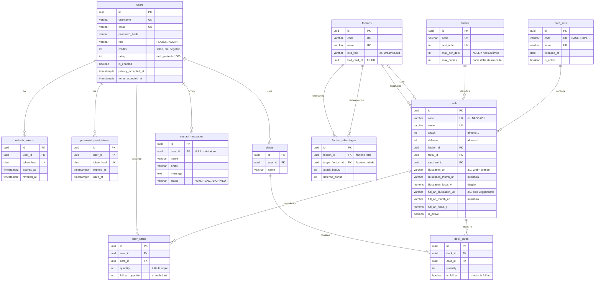
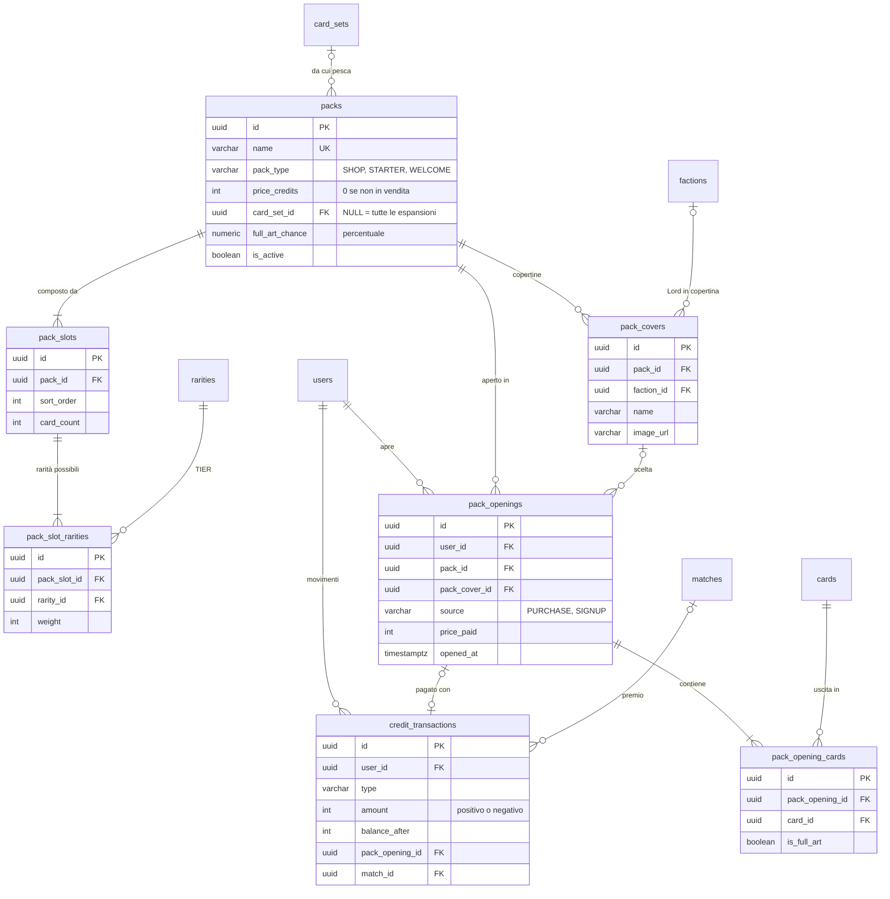
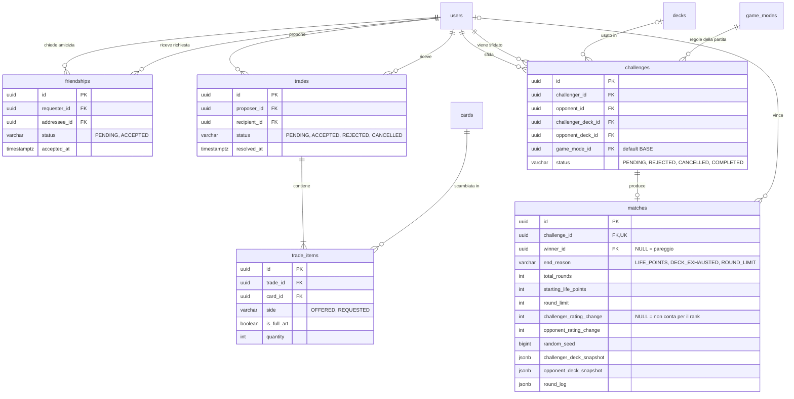
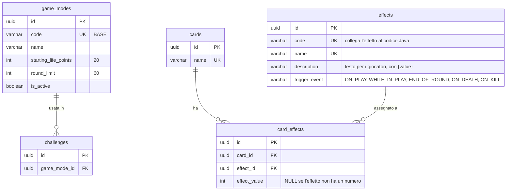

# Proposta di schema del database · Dreamscape

> 🚧 **Proposta da verificare, non ancora approvata.** Lo schema segue il [brief](#requisiti-del-brief-coperti), la [proposta di regolamento](../proposte/proposta-regolamento-dreamscape.pdf) e le convenzioni di [naming.md](../naming.md). Diventa definitivo solo dopo la revisione del team SWD: fino ad allora tabelle, colonne e nomi possono cambiare.

- **DBMS:** PostgreSQL 18 o successivo
- **Chiavi:** UUID v7 su tutte le tabelle, generati dal database con `uuidv7()`
- **Accesso:** token JWT; i refresh token si salvano in `refresh_tokens`
- **Migration:** Flyway
- **SQL completo:** [schema.sql](schema.sql), già diviso nelle future migration
- **Gioco:** Dreamscape, a tema sogni, del gruppo Somnia. Fazioni, vantaggi, rarità e Lord stanno in tabella: si ribilanciano cambiando i dati, non lo schema.

## Indice

1. [Tabelle in breve](#tabelle-in-breve)
2. [Diagrammi ER](#diagrammi-er)
3. [Scelte principali](#scelte-principali)
4. [Regole che il database non controlla](#regole-che-il-database-non-controlla)
5. [Formato dei campi JSON di `matches`](#formato-dei-campi-json-di-matches)
6. [Migration Flyway](#migration-flyway)
7. [Dati del catalogo ed espansioni](#dati-del-catalogo-ed-espansioni)
8. [Punti aperti](#punti-aperti)
9. [Requisiti del brief coperti](#requisiti-del-brief-coperti)
10. [Pagine del portale e tabelle](#pagine-del-portale-e-tabelle)
11. [Cosa è cambiato in questa versione](#cosa-è-cambiato-in-questa-versione)

---

## Tabelle in breve

| Area | Tabella | Contenuto |
|------|---------|-----------|
| Utenti e accesso | `users` | Giocatori e admin (`role`), saldo crediti, punteggio di rank, consensi Privacy e Termini |
| | `refresh_tokens` | Refresh token per l'accesso con JWT (salvati come hash) |
| | `password_reset_tokens` | Token per il recupero password |
| Catalogo carte | `factions` | Le fazioni, con il titolo e la carta del loro Lord |
| | `faction_advantages` | Chi è forte contro chi e con che bonus |
| | `rarities` | I TIER di rarità, con il limite per mazzo e le copie massime |
| | `card_sets` | Le espansioni: set base, espansione 1... |
| | `cards` | Le carte-creatura con codice, ATT, DIF, fazione, rarità, espansione, illustrazioni e ritaglio |
| Collezione e mazzi | `user_cards` | Le carte possedute da ogni utente, con il numero di copie (e quante full art) |
| | `decks` | I mazzi degli utenti |
| | `deck_cards` | Le carte di ogni mazzo |
| Pacchetti | `packs` | I pacchetti: in vendita, set iniziale, benvenuto |
| | `pack_covers` | Le copertine di un pacchetto (es. una per ogni Lord) |
| | `pack_slots` | Gli slot di un pacchetto e quante carte dà ciascuno |
| | `pack_slot_rarities` | Le rarità possibili in ogni slot, con il loro peso |
| | `pack_openings` | Ogni apertura di un pacchetto, comprato o regalato |
| | `pack_opening_cards` | Le carte uscite da ogni apertura |
| Amici e scambi | `friendships` | La lista amici: richieste in attesa e amicizie accettate |
| | `trades` | Le proposte di scambio tra amici e il loro stato |
| | `trade_items` | Le carte offerte e richieste in ogni scambio |
| Sfide | `challenges` | Le sfide tra utenti e il loro stato |
| | `matches` | Il risultato della partita simulata, round per round |
| Crediti | `credit_transactions` | Ogni movimento di crediti, con il motivo |
| Modalità ed effetti | `game_modes` | Le modalità di gioco con i loro valori (punti vita, limite di round) |
| | `effects` | Il catalogo degli effetti (lista di Nicolas), validi in ogni partita |
| | `card_effects` | Quali effetti ha ogni carta, con il loro valore |
| Contatti | `contact_messages` | I messaggi inviati dal form della pagina Contatti |

---

## Diagrammi ER

Per leggibilità i diagrammi sono divisi per area. Le colonne complete sono in [schema.sql](schema.sql).

### Utenti, catalogo, collezione e mazzi



### Pacchetti e crediti



### Scambi e sfide



### Modalità di gioco ed effetti



---

## Scelte principali

### Utenti e crediti

| Scelta | Perché |
|--------|--------|
| **Ruolo come colonna** (`users.role`) invece di una tabella dei ruoli | Ci sono solo due ruoli, PLAYER e ADMIN. Con Spring si mappa con `@Enumerated(EnumType.STRING)`. |
| **Saldo in `users.credits` + registro in `credit_transactions`** | Il saldo si legge subito senza calcoli. Il registro spiega ogni movimento e serve al marketing per le stime di redditività richieste dal brief. |
| **Crediti come `INT`**, mai decimali | I crediti sono unità intere. Niente errori di arrotondamento. |
| **Punteggio di rank già nello schema** (`users.rating`, `matches.*_rating_change`) | Il rank si fa dopo le funzionalità obbligatorie, ma le colonne ci sono già: quando si attiva non serve toccare le tabelle. Finché il rank è spento, `rating` resta 1000 e le variazioni restano `NULL`. Le leghe (Dormiente, Sognatore, Lucido, Dreamweaver) si calcolano dal punteggio, non si salvano. |
| **Consensi alla registrazione** (`privacy_accepted_at`, `terms_accepted_at`) | La registrazione ha la checkbox di Privacy Policy e Termini di servizio: si salva quando sono stati accettati. Un `CHECK` li rende obbligatori per i giocatori; l'admin, creato all'avvio, non passa dalla registrazione. |
| **Messaggi dei contatti in tabella** (`contact_messages`) | Il form della pagina Contatti salva il messaggio e l'admin lo legge nel backoffice. Non serve configurare l'invio di email. |
| **Accesso con token JWT** (`refresh_tokens`) | Il token di accesso dura poco e non si salva. Il refresh token serve a ottenerne uno nuovo: si salva come hash e si revoca al logout (`revoked_at`). Il frontend in HTML/CSS/JavaScript manda il token nell'header `Authorization`. |
| **Username ed email senza distinguere maiuscole** (indici `UNIQUE` su `LOWER()`) | "Marco" e "marco" sono lo stesso utente. In PostgreSQL si ottiene con un indice sull'espressione, senza colonne in più. |
| **Utenti si disattivano, non si cancellano** (`is_enabled`) | Lo storico di sfide e scambi resta completo. Per questo le chiavi esterne di `trades` e `challenges` verso `users` non hanno `ON DELETE CASCADE`. |

### Catalogo delle carte

| Scelta | Perché |
|--------|--------|
| **Fazioni e vantaggi in tabella** | Si cambiano dal database senza toccare il codice. Regolamento attuale: ciclo Dreams → Memories → Nightmares → Dreams con +1 attacco. `defense_bonus` resta disponibile se servisse. |
| **Lord di fazione** (`factions.lord_title`, `factions.lord_card_id`) | Ogni fazione è rappresentata da una sua Leggendaria: Dreams Lord, Nightmares Lord, Memories Lord. Sono solo titolo e immagine (pagina della fazione, copertine dei pacchetti), senza regole di gioco in più. |
| **Limiti per TIER in `rarities`**: `max_per_deck` e `max_copies` | Il regolamento ha limiti per rarità (Leggendarie 2, Epiche 4, Rare 8, Comuni libere) e copie che dipendono dalla rarità (2, ma 1 per le Leggendarie). Stando in tabella si ribilanciano senza toccare il codice. |
| **Codice stabile per ogni carta** (`cards.code`, es. `BASE-001`) | Le migration con i dati e i nomi dei file immagine usano il codice, che non cambia se si corregge il nome della carta. |
| **La carta la monta il frontend** con un componente JavaScript (frontend in HTML, CSS e JavaScript, es. una funzione `drawCard`) | Il componente riceve i dati della carta e l'illustrazione e monta: illustrazione con il suo ritaglio, cornice della fazione e della rarità con la finestra trasparente, simbolo, nome, testi, ATT e DIF. Se cambia una statistica o un testo, la carta si aggiorna da sola: nessuna immagine da ricomporre. Le 15 carte del set di prova sono il riferimento visivo. |
| **Nel database solo illustrazione e ritaglio** (`illustration_url`, `illustration_thumb_url`, `illustration_focus_y` e le stesse per la full art) | L'illustrazione è l'unica parte diversa per ogni carta. Cornici, simboli, coordinate delle zone e font sono uguali per tutte e stanno nel frontend. Il ritaglio lo fa il JavaScript, ma solo il database sa dove sta il soggetto di ogni immagine: per questo il numero è nella carta (0,40 per quasi tutte, 0,27 per Il Sogno Lucido). Il ritaglio è lo stesso del compositore: niente zoom, solo spostamento verticale. |
| **Originali intatti, al browser copie WebP** (`*_url` = grande, `*_thumb_url` = miniatura) | I PNG originali pesano 2,5–3,3 MB: con le 12 carte di oggi la prima visita alla collezione scaricherebbe circa 55 MB tra illustrazioni e cornici. L'originale resta com'è, con i suoi metadati, e non si serve al browser. Il backend serve due copie WebP: grande (larghezza 1024 px, circa 120–350 KB) per il dettaglio della carta e l'apertura dei pacchetti, miniatura (larghezza 400 px, circa 25–80 KB) per le griglie. Con le miniature la collezione scende sotto 1 MB. Due colonne in più evitano regole sul nome del file da ricordare nel frontend. |
| **Immagini in cache per sempre** (versione nel nome del file) | Ogni file ha un numero di versione, es. `base-004-v1.webp`. Il backend serve `/images/**` con `Cache-Control: public, max-age=31536000, immutable`: il browser scarica ogni immagine una volta sola. Se un'illustrazione cambia, la nuova ha un nome nuovo (`base-004-v2.webp`) e il browser la scarica perché l'URL è diverso. La carta montata non si salva: il JavaScript la rimonta a ogni pagina in pochi millisecondi, con le immagini già in cache. |
| **Illustrazioni servite dal backend** | Quelle del catalogo ufficiale stanno nel repository, quelle caricate dal backoffice in un volume Docker. Gli originali restano PNG senza conversioni, così i loro metadati non si perdono; le copie WebP sono file a parte. |
| **Full art come copia rara della stessa carta** (`user_cards.full_art_quantity`) | Solo le Leggendarie hanno la full art. Quando esce una Leggendaria da un pacchetto c'è una piccola probabilità (`packs.full_art_chance`, es. 5%) che sia full art. In partita è la stessa carta: stesse statistiche, conta per gli stessi limiti di copie. Cambia solo l'immagine, in collezione e negli scambi. |
| **Attacco e difesa almeno 1** (`CHECK`) | Con attacco almeno 1 ogni round toglie difesa; insieme al limite di round, la partita finisce sempre. |
| **Espansioni** (`card_sets`) con pacchetti legati a un'espansione (`packs.card_set_id`) | Permette pacchetti che contengono solo le carte nuove. Con `card_set_id = NULL` il pacchetto pesca da tutte le espansioni. |
| **Carte e pacchetti si disattivano, non si cancellano** (`is_active`) | Restano collegati a collezioni, mazzi e storico. |

### Collezione, pacchetti e scambi

| Scelta | Perché |
|--------|--------|
| **Collezione con `quantity`** (una riga per utente e carta) | Più semplice di una riga per ogni copia. Con le transazioni basta per garantire che negli scambi nessuna carta venga persa o duplicata. `full_art_quantity` dice quante di quelle copie sono full art. |
| **Tipi di pacchetto** (`packs.pack_type`: SHOP, STARTER, WELCOME) | Set iniziale e pacchetti di benvenuto sono pacchetti come gli altri, ma non si comprano: si regalano alla registrazione. Così si usa la stessa logica di estrazione. |
| **Slot con rarità pesate** (`pack_slots` + `pack_slot_rarities`) | Uno slot può dare rarità diverse con probabilità diverse (es. Epica peso 90, Leggendaria peso 10). Uno slot con una sola rarità dà sempre quella: così si fa anche l'Epica garantita del benvenuto. Dentro una rarità la carta si estrae a caso tra quelle attive. |
| **Copertine dei pacchetti** (`pack_covers`) | Stesso contenuto, immagine diversa: il pacchetto base ha tre copertine, una per ogni Lord. Il giocatore sceglie quella che preferisce e la scelta resta nell'apertura (`pack_openings.pack_cover_id`). |
| **Apertura immediata** (`pack_openings`, con `source`) | L'utente compra e apre subito il pacchetto: un solo passaggio, un solo record. `source` distingue i pacchetti comprati da quelli regalati alla registrazione; `price_paid` conserva il prezzo anche se poi cambia. |
| **Lista amici** (`friendships`) | A manda la richiesta, B la accetta. Una sola riga per coppia, in qualunque direzione (indice su `LEAST`/`GREATEST`). Un rifiuto o la rimozione dell'amicizia cancellano la riga. |
| **Scambi solo tra amici, senza limiti di valore** | Si propone uno scambio solo a un amico. Quantità e rarità sono libere (es. 1 Epica per 5 Comuni): nessun controllo di equilibrio, decide il destinatario accettando o rifiutando. |
| **Full art negli scambi** (`trade_items.is_full_art`) | Una copia full art vale di più: nello scambio si dice se si offrono copie normali o full art. |

### Partite e modalità

| Scelta | Perché |
|--------|--------|
| **Modalità in tabella con i loro valori** (`game_modes`: `starting_life_points`, `round_limit`) | Oggi c'è una sola modalità, ma un formato futuro che cambia solo i numeri (es. più o meno punti vita) è una riga nuova, accesa e spenta dal backoffice con `is_active`. Carte per mazzo e copie restano uguali per tutte le modalità, così un mazzo valido si usa ovunque. |
| **Carte per mazzo fisse nella configurazione** (`game.deck-size=20`), non in tabella | Cambiarle renderebbe non validi tutti i mazzi salvati. La pagina Configurazione del backoffice le mostra in sola lettura, e la pagina pubblica del Regolamento le legge dalla stessa API. |
| **Una sola modalità: BASE con gli effetti** | Il brief aggiornato permette di modificare la modalità Base: gli effetti delle carte ne fanno parte e valgono in ogni partita. BASE viene inserita insieme alla tabella e non si disattiva mai. |
| **Copia dei valori della partita in `matches`** (`starting_life_points`, `round_limit`) | Se i valori di una modalità cambiano, lo storico mostra comunque le regole con cui si è giocato. |
| **Copie dei mazzi in `matches`** (JSONB) | Lo storico resta corretto anche se l'utente modifica o cancella il mazzo, o scambia le carte, dopo la partita. |
| **Log round per round come JSONB** (`round_log`) | Si legge sempre tutto insieme, non serve interrogare i singoli round. Una tabella dei round si può aggiungere in futuro se servisse. |
| **`random_seed` in `matches`** | Con lo stesso seed il motore rigioca la stessa identica partita: utile per verifiche e test. Decide anche il lancio della moneta per l'ordine degli effetti, che si legge nel log. |
| **Stati e tipi come `VARCHAR` + `CHECK`** invece di `ENUM` | Si mappano facilmente su enum Java. Aggiungere un valore richiede solo una migration che aggiorna il `CHECK`. |
| **Effetti separati dalle carte** (catalogo + tabella di collegamento) | Lo stesso effetto si riusa su più carte con valori diversi, come prevede la lista di keyword di Nicolas (es. Protezione X, Castigo X). |
| **Momenti degli effetti** (`ON_PLAY`, `WHILE_IN_PLAY`, `END_OF_ROUND`, `ON_DEATH`, `ON_KILL`) | Sono i momenti della lista di Nicolas: quando la carta viene giocata, finché resta in campo, alla fine di ogni round, quando viene uccisa, quando uccide. |
| **Il comportamento dell'effetto sta nel codice Java**, il database salva solo `code`, momento e valore | Gli effetti sono molto diversi tra loro: descriverli tutti con colonne sarebbe rigido. Il motore associa ogni `code` alla sua classe Java. |
| **`id UUID` v7 su ogni tabella**, anche quelle di relazione (`DEFAULT uuidv7()`) | Una regola sola per tutti. Gli id finiscono negli URL e nelle API (`/sfide/{id}`): un UUID non si indovina, un numero sì. La versione 7 è ordinata nel tempo, quindi gli indici restano efficienti. In Java il campo è `java.util.UUID`; con JPA evita le chiavi composte. L'unicità reale è garantita dai vincoli `UNIQUE`. |
| **UUID generati da Hibernate** (Spring Boot 4, `@UuidGenerator(style = UuidGenerator.Style.VERSION_7)`) | L'id esiste già prima del salvataggio: niente riletture dopo l'insert, entità più semplici da testare. Il `DEFAULT uuidv7()` resta nel database per le migration con i dati e per chi scrive SQL a mano. |
| **Indici sulle chiavi esterne usate nelle ricerche** | PostgreSQL non li crea da solo. Ci sono dove serve: es. `refresh_tokens.user_id` (logout ovunque) e `pack_opening_cards.pack_opening_id` (pagina dell'apertura). Le altre chiavi esterne sono già coperte da un vincolo `UNIQUE` che inizia con quella colonna, o stanno su tabelle piccole. |
| **Date in `TIMESTAMPTZ`, in UTC** | Nessun dubbio sul fuso orario: conta per la ricompensa giornaliera e per le partite del giorno che valgono per il rank. |
| **`updated_at` aggiornato da JPA** (`@UpdateTimestamp`) | PostgreSQL non ha `ON UPDATE CURRENT_TIMESTAMP`: lo fa Hibernate a ogni salvataggio, senza trigger. |

---

## Regole che il database non controlla

Queste regole stanno nei **service** del backend, sempre dentro una transazione (`@Transactional`).

### Registrazione

Prima di tutto controlla che l'utente abbia accettato Privacy Policy e Termini di servizio e salva le due date (`privacy_accepted_at`, `terms_accepted_at`).

Nella stessa transazione che crea l'utente:
1. Apre il pacchetto **STARTER** (set iniziale: 14 Comuni e 6 Rare estratte a caso). Solo per questo pacchetto l'estrazione **non supera le copie massime per carta** (`rarities.max_copies`): una carta che ha già 2 copie si toglie dall'estrazione. Così le 20 carte formano sempre un mazzo valido. Il mazzo non si crea in automatico: lo compone il giocatore nell'editor.
2. Apre i due pacchetti **WELCOME**: uno dei due ha uno slot con l'Epica garantita.
3. Scrive le aperture con `source = 'SIGNUP'` e `price_paid = 0` e aggiorna `user_cards`. Nessun movimento di crediti.
4. Se si decide un bonus di crediti iniziale, scrive anche `credit_transactions` con `type = 'SIGNUP_BONUS'`.

Set iniziale e benvenuto si ricevono una sola volta, alla creazione dell'account.

### Mazzi

Al salvataggio di un mazzo il service verifica:
- esattamente 20 carte (valore nella configurazione, uguale per tutte le modalità);
- copie massime per carta secondo la rarità (`rarities.max_copies`);
- limite per TIER (`rarities.max_per_deck`);
- l'utente possiede abbastanza copie di ogni carta (`user_cards.quantity`, full art comprese);
- `is_full_art = TRUE` solo se la carta ha una full art e l'utente ne possiede almeno una copia (`user_cards.full_art_quantity >= 1`). Il database controlla già che la riga abbia `quantity = 1` (`chk_deck_cards_full_art`).

La full art nel mazzo è solo una scelta di aspetto: si vede nell'editor, nella lista dei mazzi e in partita, e finisce nella copia del mazzo salvata in `matches` (`isFullArt`).

Un mazzo può diventare non valido dopo, se l'utente scambia carte che ci stavano dentro. Per questo il mazzo si **ricontrolla quando si invia o si accetta una sfida**.

### Acquisto di un pacchetto

1. Controlla che il pacchetto sia di tipo SHOP e attivo, e che la copertina scelta (se c'è) sia di quel pacchetto.
2. Scala i crediti con un aggiornamento atomico che fallisce se il saldo non basta:
   ```sql
   UPDATE users SET credits = credits - :price WHERE id = :userId AND credits >= :price;
   ```
   Se aggiorna 0 righe, il saldo è insufficiente.
3. Estrae le carte lato server. Per ogni slot e per ogni carta dello slot:
   - sceglie la rarità con i pesi di `pack_slot_rarities`;
   - pesca a caso tra le carte attive di quella rarità (e dell'espansione, se il pacchetto ha `card_set_id`);
   - se la carta ha una full art, con probabilità `packs.full_art_chance` la copia è full art.
4. Scrive `pack_openings`, `pack_opening_cards`, `credit_transactions` e aggiorna `user_cards` (`quantity` e, se serve, `full_art_quantity`).

Tutto nella stessa transazione: o va a buon fine tutto, o niente.

Dal backoffice un pacchetto si può attivare solo se, per ogni rarità usata nei suoi slot, esiste almeno una carta attiva (e dell'espansione, se indicata). Altrimenti l'apertura non saprebbe cosa estrarre.

### Catalogo

- `full_art_illustration_url` si può impostare solo su carte Leggendarie.
- Le illustrazioni caricate dal backoffice si salvano così come sono (PNG), senza conversioni che toglierebbero i metadati. Il backend crea anche le due copie WebP (grande e miniatura) e salva i loro URL nella carta: `illustration_url` e `illustration_thumb_url` si impostano sempre insieme (lo controlla anche `chk_cards_thumbs`).
- Una nuova illustrazione per una carta che ne ha già una prende la versione successiva nel nome (`-v2`, `-v3`...). Un file già pubblicato non si sovrascrive mai, altrimenti i browser continuerebbero a mostrare quello vecchio dalla cache.
- `factions.lord_card_id` deve essere una Leggendaria della stessa fazione.
- Una carta ha al massimo un effetto, come prevede il regolamento attuale.

### Amici

- **Richiesta:** A cerca B per username e manda la richiesta (`status = 'PENDING'`). Non si può chiedere l'amicizia a se stessi né a chi è già amico o ha già una richiesta in sospeso. Se B aveva già chiesto l'amicizia ad A, la richiesta di A la accetta subito.
- **Risposta:** solo B (`addressee_id`) può accettare (`status = 'ACCEPTED'`, `accepted_at`) o rifiutare (la riga si cancella).
- **Rimozione:** uno dei due toglie l'amicizia e la riga si cancella. Gli scambi già conclusi restano nello storico.

### Scambi

Quando si propone uno scambio, proponente e destinatario devono essere amici (`friendships` con `status = 'ACCEPTED'`). Quantità e rarità sono libere: si può offrire 1 Epica per 5 Comuni.

Quando il destinatario accetta:
1. Ricontrolla che siano ancora amici.
2. Blocca le righe di `user_cards` coinvolte (`SELECT ... FOR UPDATE`).
3. Ricontrolla che entrambi abbiano ancora tutte le carte nelle quantità previste, contando a parte le copie full art (`is_full_art`).
4. Sposta le carte: scala `quantity` (e `full_art_quantity` per le full art), cancella le righe che arrivano a 0, aggiunge o incrementa quelle del ricevente.
5. Imposta `status = 'ACCEPTED'` e `resolved_at`.

Se un controllo fallisce, la transazione si annulla e nessuna carta si muove. Ogni scambio deve avere almeno una carta per lato.

### Sfide

Si può sfidare qualunque Dreamweaver, non solo gli amici. All'invio della sfida si controlla che la modalità sia attiva (`game_modes.is_active`).

Quando lo sfidato accetta:
1. Ricontrolla la validità di entrambi i mazzi.
2. Genera il seed e chiama il motore di gioco con i valori della modalità (punti vita, limite di round). Gli passa sempre anche gli effetti delle carte (`card_effects`).
3. Salva il risultato in `matches`, con la copia dei valori della modalità.
4. Se il rank è attivo e la partita conta (solo le prime partite del giorno contro lo stesso avversario), calcola le variazioni di punteggio, aggiorna `users.rating` e salva `*_rating_change`.
5. Imposta `status = 'COMPLETED'`.

La simulazione avviene subito, lato server, senza interazione dei giocatori.

### Contatti

- Il form è aperto anche ai visitatori; se chi scrive ha fatto l'accesso si salva anche `user_id`.
- Il service limita la lunghezza del messaggio (es. 2000 caratteri) e il numero di invii per indirizzo in poco tempo, per evitare lo spam.
- Quando l'admin apre un messaggio nel backoffice, `status` diventa `READ` e si salva `read_at`.

---

## Formato dei campi JSON di `matches`

Proposta da concordare con chi sviluppa il motore di gioco. I nomi seguono il regolamento: un **round** è un singolo scambio di colpi, uno **scontro** è la serie di round tra le stesse due creature.

**`challenger_deck_snapshot` / `opponent_deck_snapshot`**

```json
{
  "deckId": "019a2a10-1b2c-7d3e-8f40-a1b2c3d4e5f6",
  "deckName": "Mazzo offensivo",
  "cards": [
    {
      "cardId": "019a1f30-0000-7000-8000-000000000008", "cardCode": "BASE-008", "name": "L'Uomo Senza Volto", "attack": 8, "defense": 5,
      "faction": "NIGHTMARES", "rarity": "LEGENDARY", "quantity": 1, "isFullArt": true,
      "effects": [ { "code": "WEAKENING", "name": "Indebolimento", "triggerEvent": "WHILE_IN_PLAY", "value": 2 } ]
    }
  ]
}
```

Ogni carta ha al massimo un effetto: `effects` è una lista vuota se la carta non ne ha. `isFullArt` dice se nel replay della partita si mostra la full art.

**`round_log`**

```json
{
  "coinTossWinner": "OPPONENT",
  "rounds": [
    {
      "round": 3,
      "clash": 2,
      "challengerCard": { "cardId": "019a1f30-0000-7000-8000-000000000003", "attack": 4, "attackModifier": -2, "factionBonus": 0, "defenseBefore": 7, "defenseAfter": -2 },
      "opponentCard":   { "cardId": "019a1f30-0000-7000-8000-000000000008", "attack": 8, "attackModifier": 0, "factionBonus": 1, "defenseBefore": 5, "defenseAfter": 3 },
      "outcome": "CHALLENGER_CARD_DIED",
      "triggeredEffects": [
        { "cardId": "019a1f30-0000-7000-8000-000000000008", "code": "WEAKENING", "text": "Indebolimento 2: l'attacco del Faro nella Nebbia scende da 4 a 2" }
      ],
      "damageToPlayer": { "challenger": 2, "opponent": 0 },
      "lifePointsAfter": { "challenger": 18, "opponent": 20 }
    }
  ]
}
```

- `coinTossWinner`: `CHALLENGER` o `OPPONENT`. La moneta si tira prima della partita e decide l'ordine quando due effetti scattano nello stesso momento.
- `outcome`: `NONE_DIED`, `CHALLENGER_CARD_DIED`, `OPPONENT_CARD_DIED`, `BOTH_DIED`.
- `attackModifier`: quanto gli effetti cambiano l'attacco in quel round.
- L'esempio è il round 3 della partita di esempio del regolamento: l'Uomo Senza Volto (8 + 1 di bonus) uccide il Faro nella Nebbia, che aveva difesa 7, e il giocatore subisce 9 − 7 = 2 danni.

---

## Migration Flyway

### Dove e come

- Cartella: `backend/src/main/resources/db/migration/`
- Nome dei file: `V<numero>__<descrizione_in_snake_case>.sql`, con **due** underscore.
- Una migration già applicata **non si modifica mai**. Per cambiare qualcosa se ne crea una nuova.

✅ `V9__add_card_type_to_cards.sql`
❌ modificare `V2__create_card_catalog.sql` dopo che è stato eseguito

### Divisione proposta

| File | Tabelle |
|------|---------|
| `V1__create_users_and_auth.sql` | `users`, `refresh_tokens`, `password_reset_tokens` |
| `V2__create_card_catalog.sql` | `factions`, `faction_advantages`, `rarities`, `card_sets`, `cards` (+ chiave esterna del Lord), `effects`, `card_effects` |
| `V3__create_collections_and_decks.sql` | `user_cards`, `decks`, `deck_cards` |
| `V4__create_packs.sql` | `packs`, `pack_covers`, `pack_slots`, `pack_slot_rarities`, `pack_openings`, `pack_opening_cards` |
| `V5__create_friendships_and_trades.sql` | `friendships`, `trades`, `trade_items` |
| `V6__create_game_modes_challenges_and_matches.sql` | `game_modes` (+ riga BASE), `challenges`, `matches` |
| `V7__create_credit_transactions.sql` | `credit_transactions` |
| `V8__create_contact_messages.sql` | `contact_messages` |

L'ordine conta: ogni file crea tabelle che dipendono solo da quelle dei file precedenti. L'unico riferimento "all'indietro" è `factions.lord_card_id`: la colonna nasce con `factions` e la chiave esterna si aggiunge con un `ALTER TABLE` subito dopo la creazione di `cards`, nello stesso file.

### Dati iniziali

Fazioni, rarità, espansioni, carte e pacchetti si caricano con migration separate, dopo le tabelle. Come organizzarle è spiegato in [Dati del catalogo ed espansioni](#dati-del-catalogo-ed-espansioni).

### Dati finti per sviluppo e test

Con le 12 carte di prova non si forma un mazzo valido (al massimo 18 carte). Per sviluppare mazzi, sfide e motore senza aspettare il catalogo definitivo, si usano **carte inventate** in una cartella a parte:

| Cartella | Contenuto | Quando si esegue |
|----------|-----------|------------------|
| `db/migration/` | Tabelle (`V1`–`V8`) e catalogo vero (`V100` e successive) | Sempre: sviluppo, test, produzione |
| `db/testdata/` | Circa 30 carte finte (es. 12 Comuni, 9 Rare, 6 Epiche, 3 Leggendarie), pacchetti e qualche utente di prova | Solo nel profilo `dev` e nei test |

- Numerazione da `V900` in su (es. `V900__seed_test_cards.sql`), così non si scontra mai con le migration vere.
- Codici con il prefisso `TEST-` (es. `TEST-001`) e l'espansione `TEST`: non si confondono con le carte vere.
- Le illustrazioni finte possono restare vuote (`illustration_url` NULL): il frontend mostra un segnaposto.
- Le password degli utenti di prova si scrivono già cifrate con BCrypt, mai in chiaro. Gli utenti e le password di prova sono elencati nel README del backend.
- Quando arriva il catalogo vero, i dati finti restano solo per i test.

### Configurazione Spring Boot

```properties
# application.properties (comune)
spring.datasource.url=jdbc:postgresql://localhost:5432/dreamscape
spring.flyway.enabled=true
spring.flyway.locations=classpath:db/migration
spring.jpa.hibernate.ddl-auto=validate
```

```properties
# application-dev.properties (profilo dev) e configurazione dei test
spring.flyway.locations=classpath:db/migration,classpath:db/testdata
```

Utente e password del database arrivano da variabili d'ambiente, mai dal repository.

Con `validate`, Hibernate **non** modifica il database: controlla solo che le entità corrispondano alle tabelle create da Flyway.

Versioni: **Spring Boot 4** (con Hibernate 7, che genera gli UUID v7) e **PostgreSQL 18**. Prima di iniziare va controllato che la versione di Flyway inclusa in Spring Boot supporti PostgreSQL 18, e che PostgreSQL 18 ci sia anche su RDS per il deploy.

---

## Dati del catalogo ed espansioni

### Chi gestisce cosa

| Dati | Come si caricano | Perché |
|------|------------------|--------|
| **Catalogo ufficiale**: fazioni e Lord, vantaggi, rarità, espansioni, carte, effetti, pacchetti | **Migration Flyway** con i dati | Partono da sole all'avvio, sono versionate su Git e revisionate in PR, sono uguali per tutti e finiscono nell'export di consegna |
| **Gestione dal vivo**: attivare/disattivare carte e pacchetti, cambiare prezzi e pesi, correggere testi, pacchetti promozionali | **Backoffice** | Richiesto dal brief, non serve scrivere SQL |
| **Dati di prova**: utenti finti, collezioni e mazzi di esempio | Migration in una cartella separata (`db/dev-data`), caricata **solo in sviluppo** con un profilo Spring | Non devono finire nel database di consegna |
| **Primo admin** | Creato all'avvio da variabili d'ambiente (vedi [Punti aperti](#punti-aperti)) | Nessuna password nel repository |

Non serve nessuno script esterno per avviare il progetto: Flyway carica tutto da solo. Uno script può servire solo a chi sviluppa, per trasformare il foglio delle carte (oggi `carte/compositore/carte.csv`) nel file SQL della migration. Si lancia una volta e si committa l'SQL generato.

### Il database non si svuota

I dati stanno nel volume Docker di PostgreSQL e restano a ogni riavvio. Flyway esegue solo le migration nuove: quelle già applicate sono registrate nella tabella `flyway_schema_history`. Il database si azzera solo con `docker compose down -v`, e al riavvio successivo Flyway ricrea tabelle e catalogo da zero.

### Numerazione delle migration

| Numeri | Contenuto | Esempio |
|--------|-----------|---------|
| `V1`–`V99` | Struttura: tabelle, colonne, indici | `V9__add_card_type_to_cards.sql` |
| `V100`–`V199` | Catalogo ufficiale | `V100__seed_rules_data.sql`, `V101__seed_base_set.sql`, `V102__seed_packs.sql` |
| ... | Ogni espansione nuova prosegue la numerazione | `V103__expansion_1.sql` |

Flyway esegue le migration in ordine di numero. Una migration già eseguita **non si modifica mai**: per correggere una carta si scrive una nuova migration con un `UPDATE`.

### Convenzioni del catalogo

- **Codice carta:** `<codice espansione>-<numero a 3 cifre>`, es. `BASE-001`, `EXP1-012`.
- **Illustrazioni:** l'originale ha il nome del codice in minuscolo, es. `base-004.png`, e la full art `base-004-fullart.png`, come nella cartella `carte/illustrazioni`. Resta PNG, con i suoi metadati. Le copie servite al browser aggiungono la versione e, per la miniatura, `-thumb`:

  | File | Esempio | Uso |
  |------|---------|-----|
  | Originale | `base-004.png` | Archivio, non servito |
  | Grande | `/images/cards/base-004-v1.webp` | `illustration_url` |
  | Miniatura | `/images/cards/base-004-v1-thumb.webp` | `illustration_thumb_url` |
  | Full art grande e miniatura | `/images/cards/base-004-fullart-v1.webp`, `…-v1-thumb.webp` | `full_art_illustration_url`, `full_art_thumb_url` |

  Quelle del catalogo ufficiale stanno nel repository; quelle caricate dal backoffice nel volume dei file caricati.
- **Cornici e simboli:** file statici del frontend, uno per fazione e rarità, con la finestra trasparente e le coordinate delle zone (nome, simbolo, testi, ATT, DIF).
- **Riferimenti tra tabelle nelle migration:** sempre tramite `code` (fazione, rarità, espansione, carta), mai tramite `id` scritti a mano.
- **Il catalogo ufficiale cambia solo con le migration.** Se si crea dal backoffice una carta che poi viene inserita anche da una migration, Flyway fallisce sul codice duplicato.

### Esempio: dati del regolamento

```sql
-- V100__seed_rules_data.sql

INSERT INTO rarities (code, name, sort_order, max_per_deck, max_copies) VALUES
    ('COMMON',    'Comune',      1, NULL, 2),
    ('RARE',      'Rara',        2, 8,    2),
    ('EPIC',      'Epica',       3, 4,    2),
    ('LEGENDARY', 'Leggendaria', 4, 2,    1);

INSERT INTO factions (code, name, lord_title) VALUES
    ('DREAMS',     'Dreams',     'Dreams Lord'),
    ('NIGHTMARES', 'Nightmares', 'Nightmares Lord'),
    ('MEMORIES',   'Memories',   'Memories Lord');

-- Ciclo: Dreams → Memories → Nightmares → Dreams, +1 attacco
INSERT INTO faction_advantages (faction_id, target_faction_id, attack_bonus)
SELECT f.id, t.id, 1
FROM factions f
JOIN factions t ON (f.code, t.code) IN (('DREAMS', 'MEMORIES'), ('MEMORIES', 'NIGHTMARES'), ('NIGHTMARES', 'DREAMS'));
```

Dopo l'inserimento delle carte (`V101`), si collegano i Lord:

```sql
UPDATE factions f SET lord_card_id = c.id FROM cards c WHERE c.code = 'BASE-004' AND f.code = 'DREAMS';
UPDATE factions f SET lord_card_id = c.id FROM cards c WHERE c.code = 'BASE-008' AND f.code = 'NIGHTMARES';
UPDATE factions f SET lord_card_id = c.id FROM cards c WHERE c.code = 'BASE-012' AND f.code = 'MEMORIES';
```

### Esempio: pacchetti

```sql
-- V102__seed_packs.sql (estratto)

-- Pacchetto base in vendita, con tre copertine (una per Lord)
INSERT INTO packs (name, pack_type, price_credits) VALUES ('Pacchetto base', 'SHOP', 100);

INSERT INTO pack_covers (pack_id, faction_id, name, image_url, sort_order)
SELECT p.id, f.id, f.lord_title, CONCAT('/images/packs/base-', LOWER(f.code), '-v1.webp'), f.id
FROM packs p, factions f
WHERE p.name = 'Pacchetto base';

-- Slot del pacchetto base: 3 Comuni, 1 Rara, 1 Epica o Leggendaria
INSERT INTO pack_slots (pack_id, sort_order, card_count)
SELECT id, x.sort_order, x.card_count
FROM packs, (SELECT 1 AS sort_order, 3 AS card_count UNION ALL SELECT 2, 1 UNION ALL SELECT 3, 1) x
WHERE name = 'Pacchetto base';

INSERT INTO pack_slot_rarities (pack_slot_id, rarity_id, weight)
SELECT s.id, r.id, x.weight
FROM pack_slots s
JOIN packs p ON p.id = s.pack_id AND p.name = 'Pacchetto base'
JOIN (SELECT 1 AS sort_order, 'COMMON' AS code, 100 AS weight
      UNION ALL SELECT 2, 'RARE', 100
      UNION ALL SELECT 3, 'EPIC', 90
      UNION ALL SELECT 3, 'LEGENDARY', 10) x ON x.sort_order = s.sort_order
JOIN rarities r ON r.code = x.code;

-- Set iniziale: 14 Comuni e 6 Rare, regalato alla registrazione
INSERT INTO packs (name, pack_type) VALUES ('Set iniziale', 'STARTER');
-- slot 1: 14 COMMON (peso 100); slot 2: 6 RARE (peso 100)

-- Pacchetti di benvenuto: uno con l'Epica garantita
INSERT INTO packs (name, pack_type) VALUES ('Benvenuto', 'WELCOME'), ('Benvenuto con Epica', 'WELCOME');
-- "Benvenuto con Epica" ha uno slot con la sola rarità EPIC
```

I numeri (prezzo, carte per slot, pesi, `full_art_chance`) sono esempi: li decidono Maie e Nicolas.

Al primo avvio dopo il merge, Flyway esegue i file una sola volta: le carte e i pacchetti compaiono nel negozio.

---

## Punti aperti

Decisioni da prendere prima di trasformare la proposta in migration. La colonna "Proposta" è un suggerimento di partenza, non una decisione.

### Gioco ed economia

| Punto | Da decidere | Proposta | Chi |
|-------|-------------|----------|-----|
| Come si ottengono i crediti in fase 1 | Bonus di registrazione, ricompensa giornaliera, premi per le vittorie, vendita di carte doppie... Determina i valori di `credit_transactions.type` | Ricompensa giornaliera + premio vittoria; bonus di registrazione solo se set iniziale e benvenuto non bastano | DGS (Maie) |
| Set iniziale e benvenuto: dettagli | Deciso: set iniziale casuale con il limite di copie, mazzo composto dal giocatore. Da decidere: fazioni del set iniziale (tutte e tre o una scelta dal giocatore) e contenuto dei pacchetti di benvenuto | Tutte e tre le fazioni; benvenuto come il pacchetto base | Maie + Nicolas |
| Catalogo minimo | Quante carte servono in fase 1. Il set iniziale richiede almeno 7 Comuni e 3 Rare diverse; oggi le carte sono 12 (3 per rarità) | Circa 30 carte; nel frattempo si sviluppa con le carte finte di `db/testdata` | Maie + Nicolas + DGS |
| Pesi e numeri dei pacchetti | Prezzo, carte per slot, peso delle Leggendarie nello slot Epica/Leggendaria, probabilità della full art | Pacchetto da 5 carte (3 Comuni, 1 Rara, 1 Epica o Leggendaria con peso 10), full art 5% | Maie + Nicolas |
| Pesi per singola carta | Dentro una rarità ogni carta ha la stessa probabilità, oppure servono pesi per carta (`cards.drop_weight`)? | Stessa probabilità dentro la rarità | Maie + Nicolas |
| Espansioni e mazzi | Se le carte di tutte le espansioni si possono usare insieme in un mazzo, o servono formati con solo alcune espansioni | Tutte insieme in fase 1 | Nicolas + DGS |
| Pacchetti non aperti | Il pacchetto si apre subito all'acquisto, oppure l'utente può tenerlo e aprirlo dopo (servirebbe un inventario dei pacchetti) | Apertura immediata | DGS + WMD |
| Punti vita e limite di round | Valori di `game_modes` dopo le simulazioni del motore: con 20 punti vita quasi tutte le partite finiscono a mazzo esaurito (vedi i punti da valutare del regolamento) | 20 punti vita e 60 round finché non si decide | Maie + Nicolas |
| Regole del rank | Quante partite al giorno contro lo stesso avversario contano, quanto vale ogni partita (fattore K dell'Elo), premio in crediti | Prime 3 partite del giorno, K = 32 | Nicolas + Maie |
| Modifica di carte già distribuite | Se l'admin può cambiare ATT/DIF di una carta che gli utenti già possiedono. Lo storico è protetto dalle copie dei mazzi in `matches` e la carta si rimonta da sola, ma i mazzi esistenti potrebbero diventare non validi | Permessa, con ricontrollo dei mazzi alla sfida | Tutti |
| Mazzi non validi | Si possono salvare come bozza (servirebbe `decks.is_valid`) o si salvano solo i mazzi validi? | Solo mazzi validi; un mazzo che lo diventa dopo uno scambio viene segnalato alla sfida | SWD + WMD |
| Carte impegnate in scambi in attesa | Se una carta offerta in uno scambio in attesa resta usabile (in altri scambi e nei mazzi) o viene bloccata finché lo scambio non si chiude | Non bloccata: tutto si ricontrolla quando lo scambio viene accettato | SWD |
| Scadenza di scambi e sfide | Se una proposta in attesa scade dopo un certo tempo (servirebbe uno stato `EXPIRED`) | Nessuna scadenza in fase 1; chi propone può annullare | Tutti |
| Catalogo degli effetti | Lista definitiva delle keyword di Nicolas, valori di X e quali carte li hanno (righe di `effects` e `card_effects`) | La lista di Nicolas, con l'abbinamento alle carte proposto nel regolamento | Nicolas + Maie |
| Limiti della lista amici | Se c'è un numero massimo di amici o di richieste in sospeso | Nessun limite in fase 1 | SWD + DGS |
| Carte non creatura (incantesimi, potenziamenti) | Seconda variante suggerita dal brief. Servirebbero `cards.card_type` e ATT/DIF facoltativi | Non in fase 1; si aggiunge con una migration solo se si decide di farla | Tutti |
| Notifiche | Se servono avvisi per sfide e scambi ricevuti (tabella `notifications`) | Basta un contatore delle richieste in attesa, calcolato da `friendships`, `trades` e `challenges` | WMD + SWD |

### Utenti, accesso e privacy

| Punto | Da decidere | Proposta | Chi |
|-------|-------------|----------|-----|
| Durata e conservazione dei token | Accesso con JWT deciso. Da fissare: quanto durano token di accesso e refresh token, e dove li tiene il frontend | Token di accesso 15 minuti, in memoria; refresh token 7 giorni, in un cookie `HttpOnly` | SWD (con WMD) |
| Invio di email | Se il portale invia email (recupero password, verifica dell'account). Senza invio di email `password_reset_tokens` non serve | Solo recupero password, se c'è tempo; altrimenti si toglie la tabella | SWD |
| Dati alla registrazione | Se oltre a username, email e password si chiede altro (es. data di nascita per l'età minima). I consensi a Privacy e Termini sono già decisi | Solo username, email e password | DGS + SWD |
| Cancellazione dell'account | Lo schema non cancella mai gli utenti, ma la privacy prevede il diritto alla cancellazione | Anonimizzare l'utente (username ed email sostituiti, `is_enabled = FALSE`) invece di cancellarlo | SWD |
| Creazione del primo admin | Come nasce l'account admin senza scrivere una password nel repository | Creato all'avvio da username e password letti da variabili d'ambiente | SWD |

### Tecniche

| Punto | Da decidere | Proposta | Chi |
|-------|-------------|----------|-----|
| Caricamento delle immagini | Dove vanno illustrazioni e copertine caricate dal backoffice | Volume Docker del backend (deciso); nel database solo il percorso | SWD |
| Creazione delle copie WebP | Chi crea copia grande e miniatura dagli originali | Catalogo ufficiale: uno script Python (Pillow, come il compositore) le crea una volta e si salvano nel repository. Backoffice: il backend le crea al caricamento con una libreria Java che scrive WebP (es. `webp-imageio`) | SWD |
| Montaggio nel componente | Il componente della carta disegna su canvas oppure sovrappone livelli HTML/CSS | Canvas: stesso risultato delle carte di prova | WMD |
| Ruolo del compositore Python | Se prepara cornici con finestra trasparente e coordinate delle zone per il frontend (e anteprime), oppure se tutto passa in JavaScript | Da scegliere | SWD + WMD |
| Fuso orario delle date | In che fuso si salvano le date. Conta per la ricompensa giornaliera e per le partite del giorno che contano per il rank | Tutto in UTC nel database, conversione nel frontend | SWD |
| Database per i test | Con cosa si testano repository e service: H2 in memoria o PostgreSQL vero (Testcontainers). H2 non supporta `JSONB` né gli indici su espressioni come `LOWER(email)` | PostgreSQL 18 vero con Testcontainers, con i dati finti di `db/testdata`; il motore di gioco si testa senza database | SWD |
| Scambio non più valido | Cosa succede a uno scambio in attesa se l'amicizia viene tolta o se mancano le carte quando si accetta | Annullato in automatico (`CANCELLED`) e messaggio a chi prova ad accettare | SWD |
| Ricompensa giornaliera chiesta due volte insieme | Due richieste nello stesso momento non devono dare due ricompense | Colonna `users.last_daily_reward_on` e un `UPDATE ... WHERE last_daily_reward_on < :oggi` atomico, quando DGS conferma la ricompensa | SWD |
| Inizio del "giorno" | Per ricompensa giornaliera e partite del giorno che contano per il rank | Mezzanotte italiana (`Europe/Rome`); nel database le date restano in UTC | SWD + DGS |
| Sfide in attesa tra le stesse persone | Se A può mandare più sfide in attesa a B | Al massimo una sfida in attesa per coppia | SWD |
| Effetti con o senza X | Il backoffice deve sapere quando chiedere il valore dell'effetto | Colonna `effects.has_value` | SWD + Nicolas |

---

## Requisiti del brief coperti

| Requisito del brief | Dove |
|---------------------|------|
| Registrazione e accesso | `users`, `refresh_tokens`, `password_reset_tokens` |
| Saldo di crediti virtuali | `users.credits`, `credit_transactions` |
| Pacchetti con contenuto casuale e numero di carte per TIER | `packs`, `pack_slots`, `pack_slot_rarities`, `pack_openings`, `pack_opening_cards` |
| Rarità (TIER) | `rarities` |
| Collezione | `user_cards` |
| Più mazzi per utente, con vincoli verificati | `decks`, `deck_cards`, `rarities.max_per_deck`, `rarities.max_copies` + service |
| Scambi in quantità diverse, solo se il destinatario accetta (Dreamscape: solo tra amici) | `friendships`, `trades`, `trade_items` |
| Sfide con scelta del mazzo, risultato turno per turno per entrambi | `challenges`, `matches.round_log` |
| Storico delle sfide e dei risultati | `matches` |
| Creature con attacco, difesa e fazione | `cards` |
| Fazioni con vantaggi reciproci | `factions`, `faction_advantages` |
| Fine partita per punti vita, mazzi esauriti o limite, con pareggio | `matches.end_reason`, `matches.winner_id = NULL` |
| Backoffice per catalogo carte e pacchetti | `card_sets`, `cards`, `packs`, `pack_covers`, `pack_slots`, `pack_slot_rarities` (+ `users.role = 'ADMIN'`) |
| Modalità di gioco (brief aggiornato: la Base si può modificare) | `game_modes` con la sola BASE, `challenges.game_mode_id` |
| Effetti delle creature, parte della modalità Base | `effects`, `card_effects` |
| Pagine statiche (contatti, privacy, termini) | `contact_messages`, `users.privacy_accepted_at`, `users.terms_accepted_at` |
| Acquisto crediti con denaro reale | **Escluso dalla fase 1**: nessuna tabella |

---

## Pagine del portale e tabelle

Collegamento tra la sitemap del portale proposta da WMD (25 ottobre 2026) e le tabelle di questo schema. Il feedback di SWD sulla sitemap è in `docs/riunioni/feedback-sitemap-portale.pdf`; la [guida ai dati per il frontend](../api/guida-frontend.md) spiega le stesse pagine dal punto di vista di chi sviluppa il frontend. Gli URL sono quelli della sitemap; le API seguono [naming.md](../naming.md) (`/api/v1/`, risorse in inglese al plurale) e l'elenco definitivo sarà in Swagger.

| Pagina | URL | Tabelle |
|--------|-----|---------|
| Home, Il gioco / Lore | `/`, `/il-gioco` | `factions` (con Lord), `faction_advantages`, `cards` attive (galleria pubblica) |
| Regolamento | `/regolamento` | `rarities`, `factions`, `faction_advantages`, `game_modes` + carte per mazzo dalla configurazione |
| Contatti | `/contatti` | `contact_messages` |
| Registrazione | `/registrazione` | `users` (con i consensi), `pack_openings` del set iniziale e del benvenuto, `user_cards` |
| Benvenuto (nuova) | `/benvenuto` | `pack_openings` con `source = 'SIGNUP'`, `pack_opening_cards` |
| Dashboard | `/dashboard` | `users.credits`, `pack_opening_cards` (ultime carte), `friendships`, `trades` e `challenges` in attesa |
| Profilo | `/profilo` | `users` |
| Crediti | `/crediti` | `users.credits`, `credit_transactions` |
| Negozio | `/negozio` | `packs` (SHOP), `pack_covers`, `pack_slots`, `pack_slot_rarities` |
| Apertura pacchetto | `/negozio/apertura/{aperturaId}` | `pack_openings`, `pack_opening_cards` |
| Collezione, Dettaglio carta | `/collezione`, `/collezione/{id}` | `user_cards`, `cards`, `factions`, `rarities`, `faction_advantages`, `card_effects` |
| Mazzi, Editor mazzo | `/mazzi`, `/mazzi/{id}/modifica` | `decks`, `deck_cards`, `user_cards`, `rarities` (limiti e copie) |
| Amici (nuova) | `/amici` | `friendships`, `users` (ricerca per username) |
| Scambi | `/scambi`, `/scambi/nuovo`, `/scambi/{id}` | `trades`, `trade_items`, `user_cards`, `friendships` (solo amici) |
| Sfide | `/sfide`, `/sfide/nuova`, `/sfide/{id}` | `challenges`, `decks`, `game_modes`, `users` (tutti i Dreamweaver) |
| Risultato partita, Storico | `/sfide/{id}/risultato`, `/storico` | `matches` (`round_log`, copie dei mazzi) |
| Backoffice: statistiche | `/admin` | conteggi su `users`, `cards`, `packs`, `matches`, `credit_transactions` |
| Backoffice: carte | `/admin/carte` | `cards`, `card_sets`, `card_effects`, `effects` |
| Backoffice: pacchetti | `/admin/pacchetti` | `packs`, `pack_covers`, `pack_slots`, `pack_slot_rarities` |
| Backoffice: configurazione | `/admin/configurazione` | `factions`, `faction_advantages`, `rarities`, `game_modes` |
| Backoffice: messaggi (nuova) | `/admin/messaggi` | `contact_messages` |

---

## Cosa è cambiato in questa versione

### 27 ottobre 2026: immagini leggere e cache

| Cosa | Prima | Ora |
|------|-------|-----|
| Immagini servite al browser | PNG originali (2,5–3,3 MB ciascuna) | Copie WebP: grande (larghezza 1024 px) e miniatura (larghezza 400 px). Gli originali restano intatti, con i loro metadati, e non si servono |
| Colonne di `cards` | Solo `illustration_url` e `full_art_illustration_url` | In più `illustration_thumb_url` e `full_art_thumb_url`, con `chk_cards_thumbs` (copia grande e miniatura sempre insieme) |
| Nomi dei file | `base-004.png` | `base-004-v1.webp` e `base-004-v1-thumb.webp`: la versione nel nome permette la cache per sempre |
| Ritaglio (`*_focus_y`) | Nel database | Resta nel database: lo applica il JavaScript |
| Generazione degli UUID | `DEFAULT uuidv7()` | Li genera Hibernate (Spring Boot 4, `@UuidGenerator(style = VERSION_7)`); il default resta per le migration con i dati |
| Indici | Mancavano su alcune chiavi esterne | Nuovi `idx_refresh_tokens_user` e `idx_pack_opening_cards_opening` |
| `matches.winner_id` | `ON DELETE SET NULL` | Nessuna azione: una vittoria non diventa mai un pareggio |
| Set iniziale | "Estratto dalla pool" | Casuale, senza superare le copie massime per carta: forma sempre un mazzo valido, composto dal giocatore |
| Full art nel mazzo | Non indicata | `deck_cards.is_full_art`, scelta dal giocatore, salvata anche nella copia del mazzo in `matches` |
| Dati per sviluppo e test | Non previsti | Carte finte in `db/testdata` (`V900+`, codici `TEST-`), solo nel profilo `dev` e nei test |

### 26 ottobre 2026: Dreamscape, PostgreSQL e amici

| Cosa | Prima | Ora |
|------|-------|-----|
| Gioco e repository | Tema da scegliere, repository `LaboratorioIntegrato-Divine` | Dreamscape (tema sogni), gruppo Somnia, repository `gruppo-05-dreamscape` |
| DBMS | MySQL 8.4 LTS | PostgreSQL 18 o successivo: `TIMESTAMPTZ`, `JSONB`, `NUMERIC`, indici `UNIQUE` su `LOWER()` |
| Chiavi | `BIGINT AUTO_INCREMENT` | UUID v7 su tutte le tabelle (`DEFAULT uuidv7()`); `challenges.game_mode_id` senza default, il service usa BASE |
| Modalità | BASE senza effetti + EFFECTS | Solo BASE, con gli effetti (brief aggiornato); tolta `game_modes.effects_enabled` |
| Effetti | `ON_ENTER`, `BEFORE_COMBAT`, `ON_DEATH`, `END_OF_ROUND` | `ON_PLAY`, `WHILE_IN_PLAY`, `END_OF_ROUND`, `ON_DEATH`, `ON_KILL`, dalla lista di Nicolas |
| Amici | Non previsti | `friendships` (migration `V5`): richiesta da accettare; scambi solo tra amici, senza limiti di valore |
| Accesso | Sessioni o JWT da decidere | JWT deciso: `refresh_tokens` necessaria |
| Frontend | Da scegliere | HTML, CSS e JavaScript; guida ai dati in `docs/api/guida-frontend.md` |

### 25 ottobre 2026: regolamento e set di carte di prova

| Cosa | Prima | Ora |
|------|-------|-----|
| Rarità | Limite per mazzo | Limite per mazzo e copie massime per rarità (`max_copies`), 4 TIER fino a LEGENDARY |
| Immagini delle carte | `image_url` (immagine unica) | Illustrazione e ritaglio (`illustration_url`, `illustration_focus_y`, `full_art_illustration_url`, `full_art_focus_y`): la carta la monta il componente JavaScript del frontend |
| Full art | Non prevista | Copia rara della stessa carta (`full_art_quantity`, `is_full_art`, `full_art_chance`) |
| Lord di fazione | Non previsti | `factions.lord_title` e `lord_card_id`; copertine dei pacchetti in `pack_covers` |
| Pacchetti | Solo in vendita, slot fissi per TIER | Tipi SHOP/STARTER/WELCOME, slot con rarità pesate (`pack_slot_rarities`), origine dell'apertura (`source`) |
| Dotazione iniziale | Punto aperto | Decisa: set iniziale 14 Comuni + 6 Rare e 2 pacchetti di benvenuto, uno con Epica garantita |
| Valori del regolamento | Punto aperto (configurazione o tabella) | Punti vita e limite di round in `game_modes`, copiati in `matches` |
| Modalità | Solo BASE | BASE ed EFFECTS (spenta finché il motore non la supporta) |
| Effetti | `ON_ENTER`, `ON_DEATH`, `ON_ATTACK`, `PASSIVE` | `ON_ENTER`, `BEFORE_COMBAT`, `ON_DEATH`, `END_OF_ROUND`, come le fasi del regolamento |
| Partite | Turni (`total_turns`, `TURN_LIMIT`, `turn_log`) | Round (`total_rounds`, `ROUND_LIMIT`, `round_log`), `DECK_EXHAUSTED` |
| Attacco minimo | 0 | 1 |
| Rank | Non previsto | `users.rating` e `matches.*_rating_change`, usati quando il rank si attiva |
| DBMS | MySQL 8.0.16+ | MySQL 8.4 LTS |
| Consensi | Punto aperto | `users.privacy_accepted_at` e `terms_accepted_at`, obbligatori per i giocatori |
| Contatti | Nessuna tabella | `contact_messages` (migration `V8`), letti dal backoffice |
| Carte per mazzo | Punto aperto | Fisse nella configurazione (20), in sola lettura nel backoffice |
| Pagine del portale | — | Nuova sezione che collega ogni pagina della sitemap alle sue tabelle |
