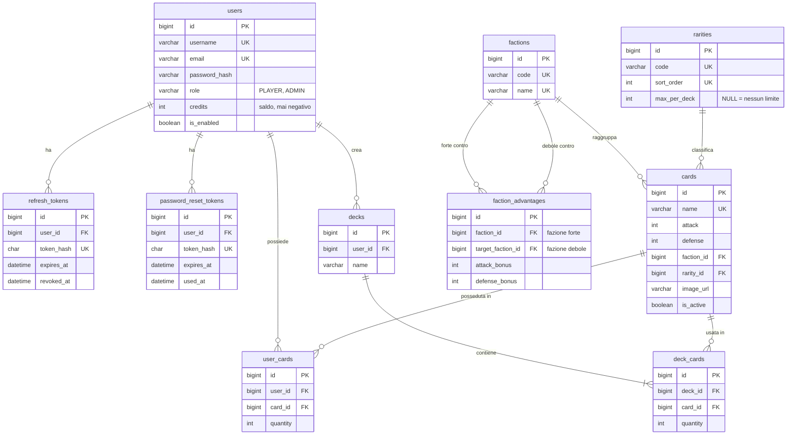
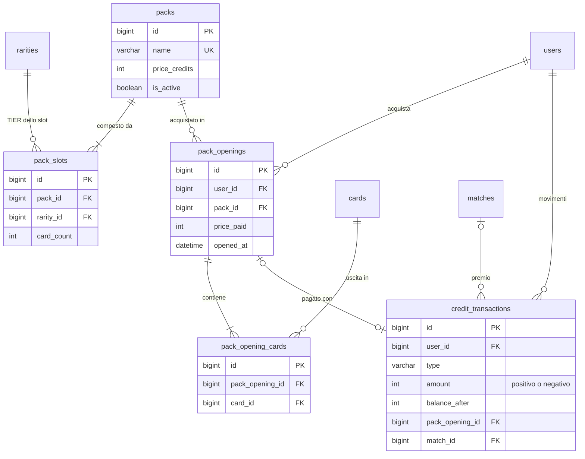
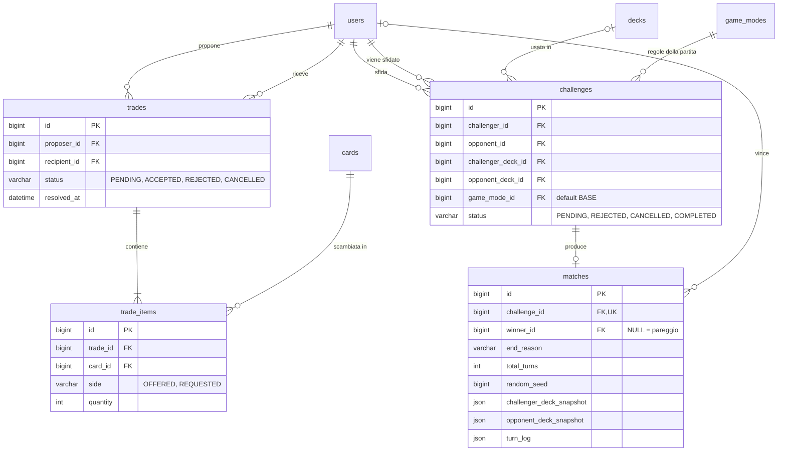
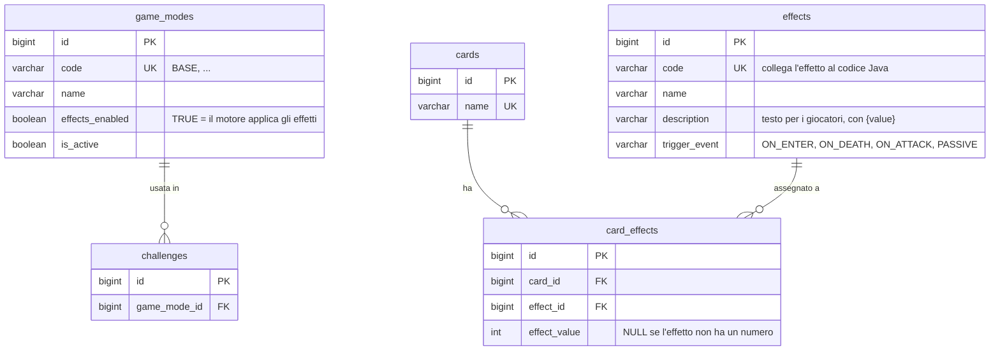

# Proposta di schema del database

> 🚧 **Proposta da verificare, non ancora approvata.** Lo schema segue il [brief](#requisiti-del-brief-coperti) e le convenzioni di [naming.md](../naming.md). Diventa definitivo solo dopo la revisione del team SWD: fino ad allora tabelle, colonne e nomi possono cambiare.

- **DBMS:** MySQL 8.0.16 o successivo (servono i vincoli `CHECK`)
- **Migration:** Flyway
- **SQL completo:** [schema.sql](schema.sql), già diviso nelle future migration

## Indice

1. [Tabelle in breve](#tabelle-in-breve)
2. [Diagrammi ER](#diagrammi-er)
3. [Scelte principali](#scelte-principali)
4. [Regole che il database non controlla](#regole-che-il-database-non-controlla)
5. [Formato dei campi JSON di `matches`](#formato-dei-campi-json-di-matches)
6. [Migration Flyway](#migration-flyway)
7. [Punti aperti](#punti-aperti)
8. [Requisiti del brief coperti](#requisiti-del-brief-coperti)

---

## Tabelle in breve

| Area | Tabella | Contenuto |
|------|---------|-----------|
| Utenti e accesso | `users` | Giocatori e admin (`role`), saldo crediti |
| | `refresh_tokens` | Token di accesso, solo se si usa JWT |
| | `password_reset_tokens` | Token per il recupero password |
| Catalogo carte | `factions` | Le fazioni |
| | `faction_advantages` | Chi è forte contro chi e con che bonus |
| | `rarities` | I TIER di rarità, con il limite per mazzo |
| | `cards` | Le carte-creatura con ATT, DIF, fazione, rarità |
| Collezione e mazzi | `user_cards` | Le carte possedute da ogni utente, con il numero di copie |
| | `decks` | I mazzi degli utenti |
| | `deck_cards` | Le carte di ogni mazzo |
| Pacchetti | `packs` | I pacchetti in vendita |
| | `pack_slots` | Quante carte di ogni TIER contiene un pacchetto |
| | `pack_openings` | Ogni acquisto/apertura di un pacchetto |
| | `pack_opening_cards` | Le carte uscite da ogni apertura |
| Scambi | `trades` | Le proposte di scambio e il loro stato |
| | `trade_items` | Le carte offerte e richieste in ogni scambio |
| Sfide | `challenges` | Le sfide tra utenti e il loro stato |
| | `matches` | Il risultato della partita simulata, turno per turno |
| Crediti | `credit_transactions` | Ogni movimento di crediti, con il motivo |
| Modalità ed effetti | `game_modes` | Le modalità di gioco (BASE sempre presente, le altre attivabili) |
| | `effects` | Il catalogo degli effetti speciali delle modalità aggiuntive |
| | `card_effects` | Quali effetti ha ogni carta, con il loro valore |

---

## Diagrammi ER

Per leggibilità i diagrammi sono divisi per area. Le colonne complete sono in [schema.sql](schema.sql).

### Utenti, catalogo, collezione e mazzi



### Pacchetti e crediti



### Scambi e sfide



### Modalità di gioco ed effetti



---

## Scelte principali

| Scelta | Perché |
|--------|--------|
| **Ruolo come colonna** (`users.role`) invece di una tabella dei ruoli | Ci sono solo due ruoli, PLAYER e ADMIN. Con Spring si mappa con `@Enumerated(EnumType.STRING)`. |
| **Saldo in `users.credits` + registro in `credit_transactions`** | Il saldo si legge subito senza calcoli. Il registro spiega ogni movimento e serve al marketing per le stime di redditività richieste dal brief. |
| **Crediti come `INT`**, mai decimali | I crediti sono unità intere. Niente errori di arrotondamento. |
| **Collezione con `quantity`** (una riga per utente e carta) | Più semplice di una riga per ogni copia. Con le transazioni basta per garantire che negli scambi nessuna carta venga persa o duplicata. |
| **Fazioni e vantaggi in tabella** | Numero di fazioni, relazioni e tipo di vantaggio sono ancora da decidere: si cambiano dal database senza toccare il codice. Due colonne (`attack_bonus`, `defense_bonus`) coprono attacco, difesa o entrambi. |
| **Limite per TIER in `rarities.max_per_deck`** | È il vincolo di bilanciamento suggerito dal brief ("massimo 8 rare e 2 mitiche"). |
| **Composizione dei pacchetti in `pack_slots`** | Il brief chiede un numero preciso di carte per ogni TIER. Dentro un TIER la carta si estrae a caso tra quelle attive. |
| **Acquisto = apertura** (`pack_openings`) | L'utente compra e apre subito il pacchetto: un solo passaggio, un solo record. `price_paid` conserva il prezzo anche se poi cambia. |
| **Copie dei mazzi in `matches`** (JSON) | Lo storico resta corretto anche se l'utente modifica o cancella il mazzo, o scambia le carte, dopo la partita. |
| **Log turno per turno come JSON** | Si legge sempre tutto insieme, non serve interrogare i singoli turni. Una tabella dei turni si può aggiungere in futuro se servisse. |
| **`random_seed` in `matches`** | Con lo stesso seed il motore rigioca la stessa identica partita: utile per verifiche e test. |
| **Carte e pacchetti si disattivano, non si cancellano** (`is_active`) | Restano collegati a collezioni, mazzi e storico. |
| **Utenti si disattivano, non si cancellano** (`is_enabled`) | Lo storico di sfide e scambi resta completo. Le chiavi esterne di `trades` e `challenges` verso `users` non hanno `ON DELETE CASCADE` anche per un limite di MySQL: non è permesso su colonne usate in un `CHECK`. |
| **Stati e tipi come `VARCHAR` + `CHECK`** invece di `ENUM` | Si mappano facilmente su enum Java. Aggiungere un valore richiede solo una migration che aggiorna il `CHECK`. |
| **Modalità in tabella** (`game_modes`) | Il brief chiede modalità "separate e attivabili": `is_active` le accende e spegne dal backoffice. BASE viene inserita insieme alla tabella e non si disattiva mai. |
| **Effetti già previsti** (`effects`, `card_effects`), anche se le modalità aggiuntive sono facoltative | Se si decide di farle, il database è pronto e non serve rifare le tabelle delle carte. Se non si fanno, le tabelle restano vuote e non danno fastidio. |
| **Effetti separati dalle carte** (catalogo + tabella di collegamento) | Lo stesso effetto si riusa su più carte con valori diversi. Una carta può avere più effetti. |
| **Il comportamento dell'effetto sta nel codice Java**, il database salva solo `code`, momento (`trigger_event`) e valore | Gli effetti possono essere molto diversi tra loro: descriverli tutti con colonne sarebbe rigido. Il motore associa ogni `code` alla sua classe Java. |
| **Gli effetti valgono solo se `game_modes.effects_enabled = TRUE`** | La modalità BASE deve restare sempre uguale e verificabile, come chiede il brief. |
| **`id BIGINT AUTO_INCREMENT` su ogni tabella**, anche quelle di relazione | Una regola sola per tutti. Con JPA evita le chiavi composte. L'unicità reale è garantita dai vincoli `UNIQUE`. |

---

## Regole che il database non controlla

Queste regole stanno nei **service** del backend, sempre dentro una transazione (`@Transactional`).

### Mazzi

Al salvataggio di un mazzo il service verifica:
- numero di carte esatto;
- copie massime per carta;
- limite per TIER (`rarities.max_per_deck`);
- l'utente possiede abbastanza copie di ogni carta (`user_cards`).

Un mazzo può diventare non valido dopo, se l'utente scambia carte che ci stavano dentro. Per questo il mazzo si **ricontrolla quando si invia o si accetta una sfida**.

### Acquisto di un pacchetto

1. Scala i crediti con un aggiornamento atomico che fallisce se il saldo non basta:
   ```sql
   UPDATE users SET credits = credits - :price WHERE id = :userId AND credits >= :price;
   ```
   Se aggiorna 0 righe, il saldo è insufficiente.
2. Estrae le carte secondo `pack_slots`, lato server.
3. Scrive `pack_openings`, `pack_opening_cards`, `credit_transactions` e aggiorna `user_cards`.

Tutto nella stessa transazione: o va a buon fine tutto, o niente.

### Scambi

Quando il destinatario accetta:
1. Blocca le righe di `user_cards` coinvolte (`SELECT ... FOR UPDATE`).
2. Ricontrolla che entrambi abbiano ancora tutte le carte nelle quantità previste.
3. Sposta le carte: scala le quantità, cancella le righe che arrivano a 0, aggiunge o incrementa quelle del ricevente.
4. Imposta `status = 'ACCEPTED'` e `resolved_at`.

Se un controllo fallisce, la transazione si annulla e nessuna carta si muove. Ogni scambio deve avere almeno una carta per lato.

### Sfide

All'invio della sfida si controlla che la modalità scelta sia attiva (`game_modes.is_active`).

Quando lo sfidato accetta:
1. Ricontrolla la validità di entrambi i mazzi.
2. Genera il seed e chiama il motore di gioco. Gli passa gli effetti delle carte (`card_effects`) **solo se** la modalità ha `effects_enabled = TRUE`.
3. Salva il risultato in `matches`.
4. Imposta `status = 'COMPLETED'`.

La simulazione avviene subito, lato server, senza interazione dei giocatori.

---

## Formato dei campi JSON di `matches`

Proposta da concordare con chi sviluppa il motore di gioco.

**`challenger_deck_snapshot` / `opponent_deck_snapshot`**

```json
{
  "deckId": 12,
  "deckName": "Mazzo offensivo",
  "cards": [
    {
      "cardId": 3, "name": "Nome carta", "attack": 4, "defense": 3,
      "faction": "FACTION_CODE", "rarity": "COMMON", "quantity": 2,
      "effects": [ { "code": "HEAL_OWNER_ON_ENTER", "triggerEvent": "ON_ENTER", "value": 2 } ]
    }
  ]
}
```

Nella modalità BASE `effects` è sempre una lista vuota.

**`turn_log`**

```json
[
  {
    "turn": 1,
    "round": 1,
    "challengerCard": { "cardId": 3, "attack": 4, "defenseBefore": 3, "defenseAfter": 1, "factionBonus": 1 },
    "opponentCard":   { "cardId": 9, "attack": 2, "defenseBefore": 5, "defenseAfter": 0, "factionBonus": 0 },
    "outcome": "OPPONENT_CARD_DIED",
    "triggeredEffects": [],
    "damageToPlayer": { "challenger": 0, "opponent": 5 },
    "lifePointsAfter": { "challenger": 20, "opponent": 15 }
  }
]
```

---

## Migration Flyway

### Dove e come

- Cartella: `backend/src/main/resources/db/migration/`
- Nome dei file: `V<numero>__<descrizione_in_snake_case>.sql`, con **due** underscore.
- Una migration già applicata **non si modifica mai**. Per cambiare qualcosa se ne crea una nuova.

✅ `V8__add_power_cost_to_cards.sql`
❌ modificare `V2__create_card_catalog.sql` dopo che è stato eseguito

### Divisione proposta

| File | Tabelle |
|------|---------|
| `V1__create_users_and_auth.sql` | `users`, `refresh_tokens`, `password_reset_tokens` |
| `V2__create_card_catalog.sql` | `factions`, `faction_advantages`, `rarities`, `cards`, `effects`, `card_effects` |
| `V3__create_collections_and_decks.sql` | `user_cards`, `decks`, `deck_cards` |
| `V4__create_packs.sql` | `packs`, `pack_slots`, `pack_openings`, `pack_opening_cards` |
| `V5__create_trades.sql` | `trades`, `trade_items` |
| `V6__create_game_modes_challenges_and_matches.sql` | `game_modes` (+ riga BASE), `challenges`, `matches` |
| `V7__create_credit_transactions.sql` | `credit_transactions` |

L'ordine conta: ogni file crea tabelle che dipendono solo da quelle dei file precedenti.

### Dati iniziali

Fazioni, rarità, carte, pacchetti e l'utente admin si caricano con migration separate, dopo le tabelle (es. `V100__seed_factions_and_rarities.sql`). Si scrivono quando DGS e Nicolas avranno definito i valori.

### Configurazione Spring Boot

```properties
spring.flyway.enabled=true
spring.jpa.hibernate.ddl-auto=validate
```

Con `validate`, Hibernate **non** modifica il database: controlla solo che le entità corrispondano alle tabelle create da Flyway.

---

## Punti aperti

| Punto | Da decidere | Chi |
|-------|-------------|-----|
| Autenticazione | JWT (serve `refresh_tokens`) o sessioni di Spring (`refresh_tokens` si toglie) | SWD |
| Come si ottengono i crediti in fase 1 | Determina i valori di `credit_transactions.type` | DGS (Maie) |
| Vincolo di bilanciamento | Solo limiti per TIER, oppure anche un "costo" per carta con budget per mazzo (servirebbe `cards.power_cost`) | Nicolas + Maie (COM-04) |
| Valori del regolamento | Punti vita, carte per mazzo, copie massime, limite di turni: nel file di configurazione o in una tabella `game_settings` modificabile dal backoffice | SWD |
| Scadenza di scambi e sfide | Se una proposta in attesa scade dopo un certo tempo (servirebbe uno stato `EXPIRED`) | Tutti |
| Modalità di gioco aggiuntive | Se si fanno, quali modalità e quali effetti (righe di `game_modes`, `effects`, `card_effects`) | Tutti |
| Momenti in cui scatta un effetto | La lista di `trigger_event` (`ON_ENTER`, `ON_DEATH`, `ON_ATTACK`, `PASSIVE`) è una proposta: si allarga o si riduce in base agli effetti scelti | Nicolas + Valerio |
| Carte non creatura (incantesimi, potenziamenti) | Seconda variante suggerita dal brief. Servirebbero `cards.card_type` e ATT/DIF facoltativi: si aggiunge con una migration solo se si decide di farla | Tutti |
| Notifiche | Se servono avvisi per sfide e scambi ricevuti (tabella `notifications`) | WMD + SWD |

---

## Requisiti del brief coperti

| Requisito del brief | Dove |
|---------------------|------|
| Registrazione e accesso | `users`, `refresh_tokens`, `password_reset_tokens` |
| Saldo di crediti virtuali | `users.credits`, `credit_transactions` |
| Pacchetti con contenuto casuale e numero di carte per TIER | `packs`, `pack_slots`, `pack_openings`, `pack_opening_cards` |
| Rarità (TIER) | `rarities` |
| Collezione | `user_cards` |
| Più mazzi per utente, con vincoli verificati | `decks`, `deck_cards`, `rarities.max_per_deck` + service |
| Scambi liberi in quantità diverse, solo se il destinatario accetta | `trades`, `trade_items` |
| Sfide con scelta del mazzo, risultato turno per turno per entrambi | `challenges`, `matches` |
| Storico delle sfide e dei risultati | `matches` |
| Creature con attacco, difesa e fazione | `cards` |
| Fazioni con vantaggi reciproci | `factions`, `faction_advantages` |
| Fine partita per punti vita, mazzi esauriti o limite di turni | `matches.end_reason` |
| Backoffice per catalogo carte e pacchetti | `cards`, `packs`, `pack_slots` (+ `users.role = 'ADMIN'`) |
| Modalità di gioco separate e attivabili | `game_modes`, `challenges.game_mode_id` |
| Abilità speciali delle creature (variante facoltativa) | `effects`, `card_effects` |
| Acquisto crediti con denaro reale | **Escluso dalla fase 1**: nessuna tabella |
