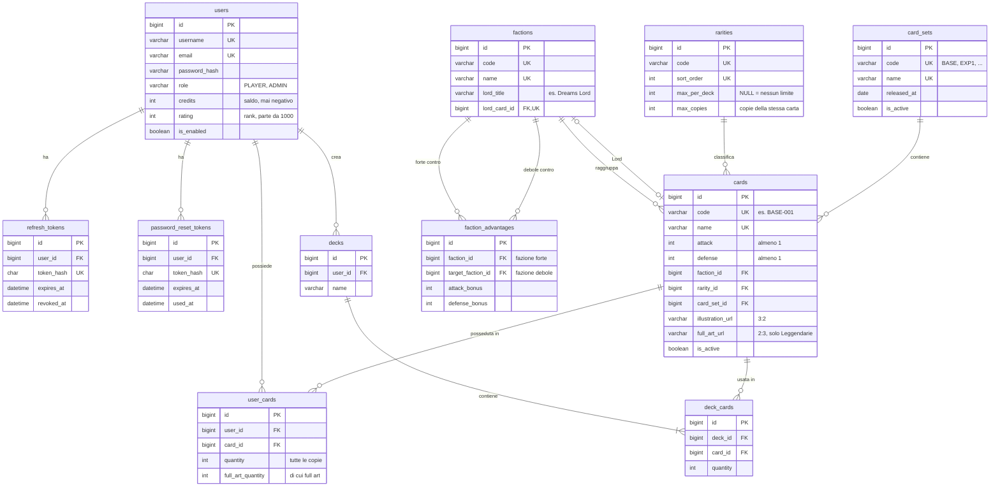
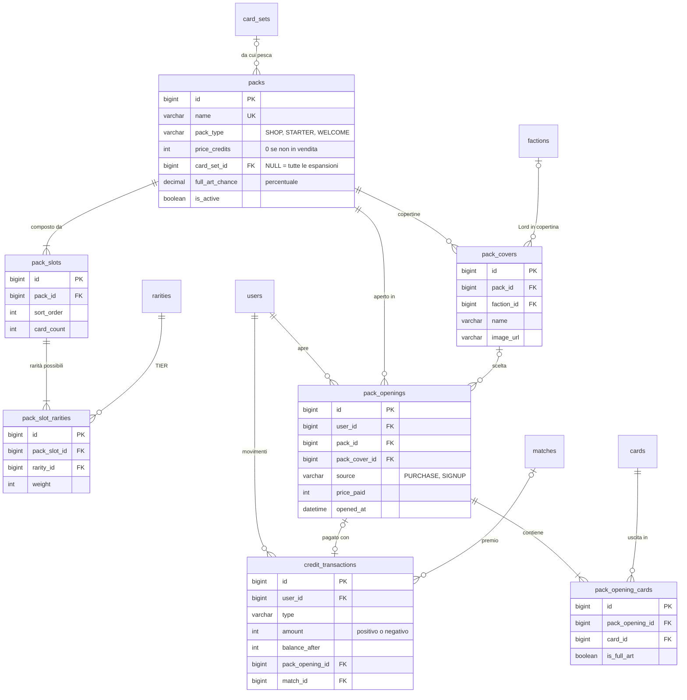
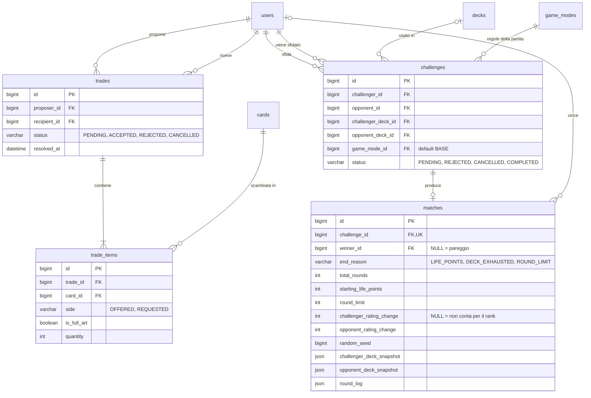
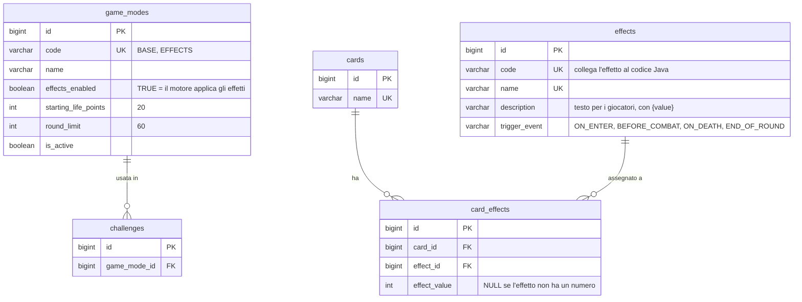

# Proposta di schema del database

> 🚧 **Proposta da verificare, non ancora approvata.** Lo schema segue il [brief](#requisiti-del-brief-coperti), la [proposta di regolamento](../proposte/proposta-regolamento-dreams-nightmares.pdf) e le convenzioni di [naming.md](../naming.md). Diventa definitivo solo dopo la revisione del team SWD: fino ad allora tabelle, colonne e nomi possono cambiare.

- **DBMS:** MySQL 8.4 LTS (servono i vincoli `CHECK`)
- **Migration:** Flyway
- **SQL completo:** [schema.sql](schema.sql), già diviso nelle future migration
- **Tema:** fazioni, vantaggi, rarità e Lord stanno in tabella. Se il gruppo sceglie un tema diverso da Dreams & Nightmares cambiano i dati, non lo schema.

## Indice

1. [Tabelle in breve](#tabelle-in-breve)
2. [Diagrammi ER](#diagrammi-er)
3. [Scelte principali](#scelte-principali)
4. [Regole che il database non controlla](#regole-che-il-database-non-controlla)
5. [Formato dei campi JSON di `matches`](#formato-dei-campi-json-di-matches)
6. [Migration Flyway](#migration-flyway)
7. [Dati del catalogo ed espansioni](#dati-del-catalogo-ed-espansioni)
8. [Punti aperti](#punti-aperti)
9. [Requisiti del brief coperti](#requisiti-del-brief-coperti)
10. [Cosa è cambiato in questa versione](#cosa-è-cambiato-in-questa-versione)

---

## Tabelle in breve

| Area | Tabella | Contenuto |
|------|---------|-----------|
| Utenti e accesso | `users` | Giocatori e admin (`role`), saldo crediti, punteggio di rank |
| | `refresh_tokens` | Token di accesso, solo se si usa JWT |
| | `password_reset_tokens` | Token per il recupero password |
| Catalogo carte | `factions` | Le fazioni, con il titolo e la carta del loro Lord |
| | `faction_advantages` | Chi è forte contro chi e con che bonus |
| | `rarities` | I TIER di rarità, con il limite per mazzo e le copie massime |
| | `card_sets` | Le espansioni: set base, espansione 1... |
| | `cards` | Le carte-creatura con codice, ATT, DIF, fazione, rarità, espansione, illustrazioni |
| Collezione e mazzi | `user_cards` | Le carte possedute da ogni utente, con il numero di copie (e quante full art) |
| | `decks` | I mazzi degli utenti |
| | `deck_cards` | Le carte di ogni mazzo |
| Pacchetti | `packs` | I pacchetti: in vendita, set iniziale, benvenuto |
| | `pack_covers` | Le copertine di un pacchetto (es. una per ogni Lord) |
| | `pack_slots` | Gli slot di un pacchetto e quante carte dà ciascuno |
| | `pack_slot_rarities` | Le rarità possibili in ogni slot, con il loro peso |
| | `pack_openings` | Ogni apertura di un pacchetto, comprato o regalato |
| | `pack_opening_cards` | Le carte uscite da ogni apertura |
| Scambi | `trades` | Le proposte di scambio e il loro stato |
| | `trade_items` | Le carte offerte e richieste in ogni scambio |
| Sfide | `challenges` | Le sfide tra utenti e il loro stato |
| | `matches` | Il risultato della partita simulata, round per round |
| Crediti | `credit_transactions` | Ogni movimento di crediti, con il motivo |
| Modalità ed effetti | `game_modes` | Le modalità di gioco con i loro valori (punti vita, limite di round) |
| | `effects` | Il catalogo degli effetti della modalità Effetti |
| | `card_effects` | Quali effetti ha ogni carta, con il loro valore |

---

## Diagrammi ER

Per leggibilità i diagrammi sono divisi per area. Le colonne complete sono in [schema.sql](schema.sql).

### Utenti, catalogo, collezione e mazzi



### Pacchetti e crediti



### Scambi e sfide



### Modalità di gioco ed effetti



---

## Scelte principali

### Utenti e crediti

| Scelta | Perché |
|--------|--------|
| **Ruolo come colonna** (`users.role`) invece di una tabella dei ruoli | Ci sono solo due ruoli, PLAYER e ADMIN. Con Spring si mappa con `@Enumerated(EnumType.STRING)`. |
| **Saldo in `users.credits` + registro in `credit_transactions`** | Il saldo si legge subito senza calcoli. Il registro spiega ogni movimento e serve al marketing per le stime di redditività richieste dal brief. |
| **Crediti come `INT`**, mai decimali | I crediti sono unità intere. Niente errori di arrotondamento. |
| **Punteggio di rank già nello schema** (`users.rating`, `matches.*_rating_change`) | Il rank si fa dopo le funzionalità obbligatorie, ma le colonne ci sono già: quando si attiva non serve toccare le tabelle. Finché il rank è spento, `rating` resta 1000 e le variazioni restano `NULL`. Le leghe (Dormiente, Sognatore, Lucido, Dreamweaver) si calcolano dal punteggio, non si salvano. |
| **Utenti si disattivano, non si cancellano** (`is_enabled`) | Lo storico di sfide e scambi resta completo. Le chiavi esterne di `trades` e `challenges` verso `users` non hanno `ON DELETE CASCADE` anche per un limite di MySQL: non è permesso su colonne usate in un `CHECK`. |

### Catalogo delle carte

| Scelta | Perché |
|--------|--------|
| **Fazioni e vantaggi in tabella** | Si cambiano dal database senza toccare il codice. Regolamento attuale: ciclo Dreams → Memories → Nightmares → Dreams con +1 attacco. `defense_bonus` resta disponibile se servisse. |
| **Lord di fazione** (`factions.lord_title`, `factions.lord_card_id`) | Ogni fazione è rappresentata da una sua Leggendaria: Dreams Lord, Nightmares Lord, Memories Lord. Sono solo titolo e immagine (pagina della fazione, copertine dei pacchetti), senza regole di gioco in più. |
| **Limiti per TIER in `rarities`**: `max_per_deck` e `max_copies` | Il regolamento ha limiti per rarità (Leggendarie 2, Epiche 4, Rare 8, Comuni libere) e copie che dipendono dalla rarità (2, ma 1 per le Leggendarie). Stando in tabella si ribilanciano senza toccare il codice. |
| **Codice stabile per ogni carta** (`cards.code`, es. `BASE-001`) | Le migration con i dati e i nomi dei file immagine usano il codice, che non cambia se si corregge il nome della carta. |
| **Si salva l'illustrazione, non la carta composta** (`illustration_url`, `full_art_url`) | Il frontend disegna la carta: cornice di fazione e rarità, nome, ATT, DIF, testi. Se dal backoffice cambia una statistica o un testo, la carta si aggiorna da sola, e l'admin carica solo l'illustrazione. Le cornici sono file del frontend, una per fazione e rarità. |
| **Full art come copia rara della stessa carta** (`user_cards.full_art_quantity`) | Solo le Leggendarie hanno la full art. Quando esce una Leggendaria da un pacchetto c'è una piccola probabilità (`packs.full_art_chance`, es. 5%) che sia full art. In partita è la stessa carta: stesse statistiche, conta per gli stessi limiti di copie. Cambia solo l'immagine, in collezione e negli scambi. |
| **Attacco e difesa almeno 1** (`CHECK`) | Con attacco almeno 1 ogni round toglie difesa e la partita Base finisce sempre da sola (regolamento, punto 14.3). |
| **Espansioni** (`card_sets`) con pacchetti legati a un'espansione (`packs.card_set_id`) | Permette pacchetti che contengono solo le carte nuove. Con `card_set_id = NULL` il pacchetto pesca da tutte le espansioni. |
| **Carte e pacchetti si disattivano, non si cancellano** (`is_active`) | Restano collegati a collezioni, mazzi e storico. |

### Collezione, pacchetti e scambi

| Scelta | Perché |
|--------|--------|
| **Collezione con `quantity`** (una riga per utente e carta) | Più semplice di una riga per ogni copia. Con le transazioni basta per garantire che negli scambi nessuna carta venga persa o duplicata. `full_art_quantity` dice quante di quelle copie sono full art. |
| **Tipi di pacchetto** (`packs.pack_type`: SHOP, STARTER, WELCOME) | Set iniziale e pacchetti di benvenuto sono pacchetti come gli altri, ma non si comprano: si regalano alla registrazione. Così si usa la stessa logica di estrazione. |
| **Slot con rarità pesate** (`pack_slots` + `pack_slot_rarities`) | Uno slot può dare rarità diverse con probabilità diverse (es. Epica peso 90, Leggendaria peso 10). Uno slot con una sola rarità dà sempre quella: così si fa anche l'Epica garantita del benvenuto. Dentro una rarità la carta si estrae a caso tra quelle attive. |
| **Copertine dei pacchetti** (`pack_covers`) | Stesso contenuto, immagine diversa: il pacchetto base ha tre copertine, una per ogni Lord. Il giocatore sceglie quella che preferisce e la scelta resta nell'apertura (`pack_openings.pack_cover_id`). |
| **Apertura immediata** (`pack_openings`, con `source`) | L'utente compra e apre subito il pacchetto: un solo passaggio, un solo record. `source` distingue i pacchetti comprati da quelli regalati alla registrazione; `price_paid` conserva il prezzo anche se poi cambia. |
| **Full art negli scambi** (`trade_items.is_full_art`) | Una copia full art vale di più: nello scambio si dice se si offrono copie normali o full art. |

### Partite e modalità

| Scelta | Perché |
|--------|--------|
| **Modalità in tabella con i loro valori** (`game_modes`: `starting_life_points`, `round_limit`) | Il brief chiede modalità "separate e attivabili": `is_active` le accende e spegne dal backoffice. Un formato futuro che cambia solo i numeri (es. Construct o Grinder) è una riga nuova. Carte per mazzo e copie restano uguali per tutte le modalità, così un mazzo valido si usa ovunque. |
| **Due modalità previste: BASE ed EFFECTS** | BASE viene inserita insieme alla tabella e non si disattiva mai. EFFECTS nasce spenta e si accende quando il motore la supporta. |
| **Copia dei valori della partita in `matches`** (`starting_life_points`, `round_limit`) | Se i valori di una modalità cambiano, lo storico mostra comunque le regole con cui si è giocato. |
| **Copie dei mazzi in `matches`** (JSON) | Lo storico resta corretto anche se l'utente modifica o cancella il mazzo, o scambia le carte, dopo la partita. |
| **Log round per round come JSON** (`round_log`) | Si legge sempre tutto insieme, non serve interrogare i singoli round. Una tabella dei round si può aggiungere in futuro se servisse. |
| **`random_seed` in `matches`** | Con lo stesso seed il motore rigioca la stessa identica partita: utile per verifiche e test. Decide anche il lancio della moneta della modalità Effetti, che si legge nel log. |
| **Stati e tipi come `VARCHAR` + `CHECK`** invece di `ENUM` | Si mappano facilmente su enum Java. Aggiungere un valore richiede solo una migration che aggiorna il `CHECK`. |
| **Effetti separati dalle carte** (catalogo + tabella di collegamento) | Lo stesso effetto si riusa su più carte con valori diversi, come prevede il catalogo di circa 20 effetti fissi del regolamento. |
| **Momenti degli effetti = fasi del round** (`ON_ENTER`, `BEFORE_COMBAT`, `ON_DEATH`, `END_OF_ROUND`) | Sono i quattro momenti del regolamento: fase iniziale, prima del calcolo dei danni, fase finale per le creature morte e per quelle vive. |
| **Il comportamento dell'effetto sta nel codice Java**, il database salva solo `code`, momento e valore | Gli effetti sono molto diversi tra loro: descriverli tutti con colonne sarebbe rigido. Il motore associa ogni `code` alla sua classe Java. |
| **Gli effetti valgono solo se `game_modes.effects_enabled = TRUE`** | La modalità BASE deve restare sempre uguale e verificabile, come chiede il brief. |
| **`id BIGINT AUTO_INCREMENT` su ogni tabella**, anche quelle di relazione | Una regola sola per tutti. Con JPA evita le chiavi composte. L'unicità reale è garantita dai vincoli `UNIQUE`. |

---

## Regole che il database non controlla

Queste regole stanno nei **service** del backend, sempre dentro una transazione (`@Transactional`).

### Registrazione

Nella stessa transazione che crea l'utente:
1. Apre il pacchetto **STARTER** (set iniziale: 14 Comuni e 6 Rare estratte dalla pool).
2. Apre i due pacchetti **WELCOME**: uno dei due ha uno slot con l'Epica garantita.
3. Scrive le aperture con `source = 'SIGNUP'` e `price_paid = 0` e aggiorna `user_cards`. Nessun movimento di crediti.
4. Se si decide un bonus di crediti iniziale, scrive anche `credit_transactions` con `type = 'SIGNUP_BONUS'`.

Set iniziale e benvenuto si ricevono una sola volta, alla creazione dell'account.

### Mazzi

Al salvataggio di un mazzo il service verifica:
- esattamente 20 carte (valore nella configurazione, uguale per tutte le modalità);
- copie massime per carta secondo la rarità (`rarities.max_copies`);
- limite per TIER (`rarities.max_per_deck`);
- l'utente possiede abbastanza copie di ogni carta (`user_cards.quantity`, full art comprese).

Un mazzo può diventare non valido dopo, se l'utente scambia carte che ci stavano dentro. Per questo il mazzo si **ricontrolla quando si invia o si accetta una sfida**.

### Acquisto di un pacchetto

1. Controlla che il pacchetto sia di tipo SHOP e attivo, e che la copertina scelta (se c'è) sia di quel pacchetto.
2. Scala i crediti con un aggiornamento atomico che fallisce se il saldo non basta:
   ```sql
   UPDATE users SET credits = credits - :price WHERE id = :userId AND credits >= :price;
   ```
   Se aggiorna 0 righe, il saldo è insufficiente.
3. Estrae le carte lato server. Per ogni slot e per ogni carta dello slot:
   - sceglie la rarità con i pesi di `pack_slot_rarities`;
   - pesca a caso tra le carte attive di quella rarità (e dell'espansione, se il pacchetto ha `card_set_id`);
   - se la carta ha una full art, con probabilità `packs.full_art_chance` la copia è full art.
4. Scrive `pack_openings`, `pack_opening_cards`, `credit_transactions` e aggiorna `user_cards` (`quantity` e, se serve, `full_art_quantity`).

Tutto nella stessa transazione: o va a buon fine tutto, o niente.

Dal backoffice un pacchetto si può attivare solo se, per ogni rarità usata nei suoi slot, esiste almeno una carta attiva (e dell'espansione, se indicata). Altrimenti l'apertura non saprebbe cosa estrarre.

### Catalogo

- `full_art_url` si può impostare solo su carte Leggendarie.
- `factions.lord_card_id` deve essere una Leggendaria della stessa fazione.
- Una carta ha al massimo un effetto, come prevede il regolamento attuale.

### Scambi

Quando il destinatario accetta:
1. Blocca le righe di `user_cards` coinvolte (`SELECT ... FOR UPDATE`).
2. Ricontrolla che entrambi abbiano ancora tutte le carte nelle quantità previste, contando a parte le copie full art (`is_full_art`).
3. Sposta le carte: scala `quantity` (e `full_art_quantity` per le full art), cancella le righe che arrivano a 0, aggiunge o incrementa quelle del ricevente.
4. Imposta `status = 'ACCEPTED'` e `resolved_at`.

Se un controllo fallisce, la transazione si annulla e nessuna carta si muove. Ogni scambio deve avere almeno una carta per lato.

### Sfide

All'invio della sfida si controlla che la modalità scelta sia attiva (`game_modes.is_active`).

Quando lo sfidato accetta:
1. Ricontrolla la validità di entrambi i mazzi.
2. Genera il seed e chiama il motore di gioco con i valori della modalità (punti vita, limite di round). Gli passa gli effetti delle carte (`card_effects`) **solo se** la modalità ha `effects_enabled = TRUE`.
3. Salva il risultato in `matches`, con la copia dei valori della modalità.
4. Se il rank è attivo e la partita conta (solo le prime partite del giorno contro lo stesso avversario), calcola le variazioni di punteggio, aggiorna `users.rating` e salva `*_rating_change`.
5. Imposta `status = 'COMPLETED'`.

La simulazione avviene subito, lato server, senza interazione dei giocatori.

---

## Formato dei campi JSON di `matches`

Proposta da concordare con chi sviluppa il motore di gioco. I nomi seguono il regolamento: un **round** è un singolo scambio di colpi, uno **scontro** è la serie di round tra le stesse due creature.

**`challenger_deck_snapshot` / `opponent_deck_snapshot`**

```json
{
  "deckId": 12,
  "deckName": "Mazzo offensivo",
  "cards": [
    {
      "cardId": 6, "cardCode": "BASE-006", "name": "La Caduta Senza Fine", "attack": 7, "defense": 3,
      "faction": "NIGHTMARES", "rarity": "RARE", "quantity": 2,
      "effects": [ { "code": "DESPERATION", "triggerEvent": "BEFORE_COMBAT", "value": 2 } ]
    }
  ]
}
```

Nella modalità BASE `effects` è sempre una lista vuota.

**`round_log`**

```json
{
  "coinTossWinner": null,
  "rounds": [
    {
      "round": 3,
      "clash": 2,
      "challengerCard": { "cardId": 1, "attack": 2, "factionBonus": 0, "defenseBefore": 2, "defenseAfter": -6 },
      "opponentCard":   { "cardId": 6, "attack": 7, "factionBonus": 1, "defenseBefore": 3, "defenseAfter": 1 },
      "outcome": "CHALLENGER_CARD_DIED",
      "triggeredEffects": [],
      "damageToPlayer": { "challenger": 6, "opponent": 0 },
      "lifePointsAfter": { "challenger": 14, "opponent": 19 }
    }
  ]
}
```

- `coinTossWinner`: `CHALLENGER` o `OPPONENT` nella modalità Effetti (decide l'ordine degli effetti), `null` nella Base.
- `outcome`: `NONE_DIED`, `CHALLENGER_CARD_DIED`, `OPPONENT_CARD_DIED`, `BOTH_DIED`.
- L'esempio è il round 3 della partita di esempio del regolamento: la Caduta (7 + 1 di bonus) uccide il Rifugio, che aveva difesa 2, e il giocatore subisce 8 − 2 = 6 danni.

---

## Migration Flyway

### Dove e come

- Cartella: `backend/src/main/resources/db/migration/`
- Nome dei file: `V<numero>__<descrizione_in_snake_case>.sql`, con **due** underscore.
- Una migration già applicata **non si modifica mai**. Per cambiare qualcosa se ne crea una nuova.

✅ `V8__add_card_type_to_cards.sql`
❌ modificare `V2__create_card_catalog.sql` dopo che è stato eseguito

### Divisione proposta

| File | Tabelle |
|------|---------|
| `V1__create_users_and_auth.sql` | `users`, `refresh_tokens`, `password_reset_tokens` |
| `V2__create_card_catalog.sql` | `factions`, `faction_advantages`, `rarities`, `card_sets`, `cards` (+ chiave esterna del Lord), `effects`, `card_effects` |
| `V3__create_collections_and_decks.sql` | `user_cards`, `decks`, `deck_cards` |
| `V4__create_packs.sql` | `packs`, `pack_covers`, `pack_slots`, `pack_slot_rarities`, `pack_openings`, `pack_opening_cards` |
| `V5__create_trades.sql` | `trades`, `trade_items` |
| `V6__create_game_modes_challenges_and_matches.sql` | `game_modes` (+ righe BASE ed EFFECTS), `challenges`, `matches` |
| `V7__create_credit_transactions.sql` | `credit_transactions` |

L'ordine conta: ogni file crea tabelle che dipendono solo da quelle dei file precedenti. L'unico riferimento "all'indietro" è `factions.lord_card_id`: la colonna nasce con `factions` e la chiave esterna si aggiunge con un `ALTER TABLE` subito dopo la creazione di `cards`, nello stesso file.

### Dati iniziali

Fazioni, rarità, espansioni, carte e pacchetti si caricano con migration separate, dopo le tabelle. Come organizzarle è spiegato in [Dati del catalogo ed espansioni](#dati-del-catalogo-ed-espansioni).

### Configurazione Spring Boot

```properties
spring.flyway.enabled=true
spring.jpa.hibernate.ddl-auto=validate
```

Con `validate`, Hibernate **non** modifica il database: controlla solo che le entità corrispondano alle tabelle create da Flyway.

---

## Dati del catalogo ed espansioni

### Chi gestisce cosa

| Dati | Come si caricano | Perché |
|------|------------------|--------|
| **Catalogo ufficiale**: fazioni e Lord, vantaggi, rarità, espansioni, carte, effetti, pacchetti | **Migration Flyway** con i dati | Partono da sole all'avvio, sono versionate su Git e revisionate in PR, sono uguali per tutti e finiscono nell'export di consegna |
| **Gestione dal vivo**: attivare/disattivare carte e pacchetti, cambiare prezzi e pesi, correggere testi, pacchetti promozionali | **Backoffice** | Richiesto dal brief, non serve scrivere SQL |
| **Dati di prova**: utenti finti, collezioni e mazzi di esempio | Migration in una cartella separata (`db/dev-data`), caricata **solo in sviluppo** con un profilo Spring | Non devono finire nel database di consegna |
| **Primo admin** | Creato all'avvio da variabili d'ambiente (vedi [Punti aperti](#punti-aperti)) | Nessuna password nel repository |

Non serve nessuno script esterno per avviare il progetto: Flyway carica tutto da solo. Uno script può servire solo a chi sviluppa, per trasformare il foglio delle carte (oggi `carte/compositore/carte.csv`) nel file SQL della migration. Si lancia una volta e si committa l'SQL generato.

### Il database non si svuota

I dati stanno nel volume Docker di MySQL e restano a ogni riavvio. Flyway esegue solo le migration nuove: quelle già applicate sono registrate nella tabella `flyway_schema_history`. Il database si azzera solo con `docker compose down -v`, e al riavvio successivo Flyway ricrea tabelle e catalogo da zero.

### Numerazione delle migration

| Numeri | Contenuto | Esempio |
|--------|-----------|---------|
| `V1`–`V99` | Struttura: tabelle, colonne, indici | `V8__add_card_type_to_cards.sql` |
| `V100`–`V199` | Catalogo ufficiale | `V100__seed_rules_data.sql`, `V101__seed_base_set.sql`, `V102__seed_packs.sql` |
| ... | Ogni espansione nuova prosegue la numerazione | `V103__expansion_1.sql` |

Flyway esegue le migration in ordine di numero. Una migration già eseguita **non si modifica mai**: per correggere una carta si scrive una nuova migration con un `UPDATE`.

### Convenzioni del catalogo

- **Codice carta:** `<codice espansione>-<numero a 3 cifre>`, es. `BASE-001`, `EXP1-012`.
- **Immagini:** il file ha il nome del codice in minuscolo. Illustrazione `base-004.webp`, full art `base-004-fullart.webp`, come nella cartella `carte/illustrazioni`. Le immagini del catalogo ufficiale stanno nel repository; quelle caricate dal backoffice nel volume dei file caricati.
- **Riferimenti tra tabelle nelle migration:** sempre tramite `code` (fazione, rarità, espansione, carta), mai tramite `id` scritti a mano.
- **Il catalogo ufficiale cambia solo con le migration.** Se si crea dal backoffice una carta che poi viene inserita anche da una migration, Flyway fallisce sul codice duplicato.

### Esempio: dati del regolamento

```sql
-- V100__seed_rules_data.sql

INSERT INTO rarities (code, name, sort_order, max_per_deck, max_copies) VALUES
    ('COMMON',    'Comune',      1, NULL, 2),
    ('RARE',      'Rara',        2, 8,    2),
    ('EPIC',      'Epica',       3, 4,    2),
    ('LEGENDARY', 'Leggendaria', 4, 2,    1);

INSERT INTO factions (code, name, lord_title) VALUES
    ('DREAMS',     'Dreams',     'Dreams Lord'),
    ('NIGHTMARES', 'Nightmares', 'Nightmares Lord'),
    ('MEMORIES',   'Memories',   'Memories Lord');

-- Ciclo: Dreams → Memories → Nightmares → Dreams, +1 attacco
INSERT INTO faction_advantages (faction_id, target_faction_id, attack_bonus)
SELECT f.id, t.id, 1
FROM factions f
JOIN factions t ON (f.code, t.code) IN (('DREAMS', 'MEMORIES'), ('MEMORIES', 'NIGHTMARES'), ('NIGHTMARES', 'DREAMS'));
```

Dopo l'inserimento delle carte (`V101`), si collegano i Lord:

```sql
UPDATE factions f JOIN cards c ON c.code = 'BASE-004' SET f.lord_card_id = c.id WHERE f.code = 'DREAMS';
UPDATE factions f JOIN cards c ON c.code = 'BASE-008' SET f.lord_card_id = c.id WHERE f.code = 'NIGHTMARES';
UPDATE factions f JOIN cards c ON c.code = 'BASE-012' SET f.lord_card_id = c.id WHERE f.code = 'MEMORIES';
```

### Esempio: pacchetti

```sql
-- V102__seed_packs.sql (estratto)

-- Pacchetto base in vendita, con tre copertine (una per Lord)
INSERT INTO packs (name, pack_type, price_credits) VALUES ('Pacchetto base', 'SHOP', 100);

INSERT INTO pack_covers (pack_id, faction_id, name, image_url, sort_order)
SELECT p.id, f.id, f.lord_title, CONCAT('/images/packs/base-', LOWER(f.code), '.webp'), f.id
FROM packs p, factions f
WHERE p.name = 'Pacchetto base';

-- Slot del pacchetto base: 3 Comuni, 1 Rara, 1 Epica o Leggendaria
INSERT INTO pack_slots (pack_id, sort_order, card_count)
SELECT id, x.sort_order, x.card_count
FROM packs, (SELECT 1 AS sort_order, 3 AS card_count UNION ALL SELECT 2, 1 UNION ALL SELECT 3, 1) x
WHERE name = 'Pacchetto base';

INSERT INTO pack_slot_rarities (pack_slot_id, rarity_id, weight)
SELECT s.id, r.id, x.weight
FROM pack_slots s
JOIN packs p ON p.id = s.pack_id AND p.name = 'Pacchetto base'
JOIN (SELECT 1 AS sort_order, 'COMMON' AS code, 100 AS weight
      UNION ALL SELECT 2, 'RARE', 100
      UNION ALL SELECT 3, 'EPIC', 90
      UNION ALL SELECT 3, 'LEGENDARY', 10) x ON x.sort_order = s.sort_order
JOIN rarities r ON r.code = x.code;

-- Set iniziale: 14 Comuni e 6 Rare, regalato alla registrazione
INSERT INTO packs (name, pack_type) VALUES ('Set iniziale', 'STARTER');
-- slot 1: 14 COMMON (peso 100); slot 2: 6 RARE (peso 100)

-- Pacchetti di benvenuto: uno con l'Epica garantita
INSERT INTO packs (name, pack_type) VALUES ('Benvenuto', 'WELCOME'), ('Benvenuto con Epica', 'WELCOME');
-- "Benvenuto con Epica" ha uno slot con la sola rarità EPIC
```

I numeri (prezzo, carte per slot, pesi, `full_art_chance`) sono esempi: li decidono Maie e Nicolas.

Al primo avvio dopo il merge, Flyway esegue i file una sola volta: le carte e i pacchetti compaiono nel negozio.

---

## Punti aperti

Decisioni da prendere prima di trasformare la proposta in migration. La colonna "Proposta" è un suggerimento di partenza, non una decisione.

### Gioco ed economia

| Punto | Da decidere | Proposta | Chi |
|-------|-------------|----------|-----|
| Come si ottengono i crediti in fase 1 | Bonus di registrazione, ricompensa giornaliera, premi per le vittorie, vendita di carte doppie... Determina i valori di `credit_transactions.type` | Ricompensa giornaliera + premio vittoria; bonus di registrazione solo se set iniziale e benvenuto non bastano | DGS (Maie) |
| Set iniziale e benvenuto: dettagli | Fazioni del set iniziale (tutte e tre o una scelta dal giocatore) e contenuto dei pacchetti di benvenuto (punto 14.7 del regolamento) | Tutte e tre le fazioni; benvenuto come il pacchetto base | Maie + Nicolas |
| Pesi e numeri dei pacchetti | Prezzo, carte per slot, peso delle Leggendarie nello slot Epica/Leggendaria, probabilità della full art | Pacchetto da 5 carte (3 Comuni, 1 Rara, 1 Epica o Leggendaria con peso 10), full art 5% | Maie + Nicolas |
| Pesi per singola carta | Dentro una rarità ogni carta ha la stessa probabilità, oppure servono pesi per carta (`cards.drop_weight`)? | Stessa probabilità dentro la rarità | Maie + Nicolas |
| Espansioni e mazzi | Se le carte di tutte le espansioni si possono usare insieme in un mazzo, o servono formati con solo alcune espansioni | Tutte insieme in fase 1 | Nicolas + DGS |
| Pacchetti non aperti | Il pacchetto si apre subito all'acquisto, oppure l'utente può tenerlo e aprirlo dopo (servirebbe un inventario dei pacchetti) | Apertura immediata | DGS + WMD |
| Punti vita e limite di round | Valori di `game_modes` dopo le simulazioni del motore: con 20 punti vita quasi tutte le partite finiscono a mazzo esaurito (regolamento 14.1 e 14.2) | 20 punti vita e 60 round finché non si decide | Maie + Nicolas |
| Regole del rank | Quante partite al giorno contro lo stesso avversario contano, quanto vale ogni partita (fattore K dell'Elo), premio in crediti | Prime 3 partite del giorno, K = 32 | Nicolas + Maie |
| Modifica di carte già distribuite | Se l'admin può cambiare ATT/DIF di una carta che gli utenti già possiedono. Lo storico è protetto dalle copie dei mazzi in `matches` e la carta si ridisegna da sola, ma i mazzi esistenti potrebbero diventare non validi | Permessa, con ricontrollo dei mazzi alla sfida | Tutti |
| Mazzi non validi | Si possono salvare come bozza (servirebbe `decks.is_valid`) o si salvano solo i mazzi validi? | Solo mazzi validi; un mazzo che lo diventa dopo uno scambio viene segnalato alla sfida | SWD + WMD |
| Carte impegnate in scambi in attesa | Se una carta offerta in uno scambio in attesa resta usabile (in altri scambi e nei mazzi) o viene bloccata finché lo scambio non si chiude | Non bloccata: tutto si ricontrolla quando lo scambio viene accettato | SWD |
| Scadenza di scambi e sfide | Se una proposta in attesa scade dopo un certo tempo (servirebbe uno stato `EXPIRED`) | Nessuna scadenza in fase 1; chi propone può annullare | Tutti |
| Catalogo degli effetti | Lista definitiva dei circa 20 effetti e quali carte li hanno (righe di `effects` e `card_effects`) | Il catalogo della proposta di regolamento | Nicolas + Valerio |
| Carte non creatura (incantesimi, potenziamenti) | Seconda variante suggerita dal brief. Servirebbero `cards.card_type` e ATT/DIF facoltativi | Non in fase 1; si aggiunge con una migration solo se si decide di farla | Tutti |
| Notifiche | Se servono avvisi per sfide e scambi ricevuti (tabella `notifications`) | Basta un contatore delle richieste in attesa, calcolato da `trades` e `challenges` | WMD + SWD |

### Utenti, accesso e privacy

| Punto | Da decidere | Proposta | Chi |
|-------|-------------|----------|-----|
| Autenticazione | Sessioni di Spring Security (`refresh_tokens` si toglie) o JWT (serve `refresh_tokens`) | Sessioni con cookie `HttpOnly` | SWD |
| Sessioni dopo un riavvio | Solo con le sessioni: in memoria (si perdono a ogni riavvio del server) o su MySQL con Spring Session JDBC (servono le sue tabelle in una migration) | In memoria in fase 1 | SWD |
| Invio di email | Se il portale invia email (recupero password, verifica dell'account). Senza invio di email `password_reset_tokens` non serve | Solo recupero password, se c'è tempo; altrimenti si toglie la tabella | SWD |
| Dati e consensi alla registrazione | Quali dati si chiedono (es. data di nascita per l'età minima) e se si registra l'accettazione della Privacy Policy (servirebbe `users.privacy_accepted_at`) | Salvare la data di accettazione della Privacy Policy | DGS + SWD |
| Cancellazione dell'account | Lo schema non cancella mai gli utenti, ma la privacy prevede il diritto alla cancellazione | Anonimizzare l'utente (username ed email sostituiti, `is_enabled = FALSE`) invece di cancellarlo | SWD |
| Creazione del primo admin | Come nasce l'account admin senza scrivere una password nel repository | Creato all'avvio da username e password letti da variabili d'ambiente | SWD |

### Tecniche

| Punto | Da decidere | Proposta | Chi |
|-------|-------------|----------|-----|
| Disegno della carta nel frontend | Come il frontend compone cornice, illustrazione e testi (componente HTML/CSS o canvas), con le cornici del set di prova come riferimento | Componente HTML/CSS con le cornici come immagini | WMD + DGS |
| Caricamento delle immagini | Dove vanno illustrazioni e copertine caricate dal backoffice | Cartella del server (volume Docker); nel database solo il percorso | SWD + WMD |
| Fuso orario delle date | In che fuso si salvano le date. Conta per la ricompensa giornaliera e per le partite del giorno che contano per il rank | Tutto in UTC nel database, conversione nel frontend | SWD |
| Database per i test | Con cosa si testano repository e service: H2 in memoria o MySQL vero (Testcontainers o database di test). H2 non supporta bene colonne `JSON` e alcuni `CHECK` | MySQL vero per i test di integrazione; il motore di gioco si testa senza database | SWD |

---

## Requisiti del brief coperti

| Requisito del brief | Dove |
|---------------------|------|
| Registrazione e accesso | `users`, `refresh_tokens`, `password_reset_tokens` |
| Saldo di crediti virtuali | `users.credits`, `credit_transactions` |
| Pacchetti con contenuto casuale e numero di carte per TIER | `packs`, `pack_slots`, `pack_slot_rarities`, `pack_openings`, `pack_opening_cards` |
| Rarità (TIER) | `rarities` |
| Collezione | `user_cards` |
| Più mazzi per utente, con vincoli verificati | `decks`, `deck_cards`, `rarities.max_per_deck`, `rarities.max_copies` + service |
| Scambi liberi in quantità diverse, solo se il destinatario accetta | `trades`, `trade_items` |
| Sfide con scelta del mazzo, risultato turno per turno per entrambi | `challenges`, `matches.round_log` |
| Storico delle sfide e dei risultati | `matches` |
| Creature con attacco, difesa e fazione | `cards` |
| Fazioni con vantaggi reciproci | `factions`, `faction_advantages` |
| Fine partita per punti vita, mazzi esauriti o limite, con pareggio | `matches.end_reason`, `matches.winner_id = NULL` |
| Backoffice per catalogo carte e pacchetti | `card_sets`, `cards`, `packs`, `pack_covers`, `pack_slots`, `pack_slot_rarities` (+ `users.role = 'ADMIN'`) |
| Modalità di gioco separate e attivabili | `game_modes`, `challenges.game_mode_id` |
| Abilità speciali delle creature (variante facoltativa) | `effects`, `card_effects` |
| Acquisto crediti con denaro reale | **Escluso dalla fase 1**: nessuna tabella |

---

## Cosa è cambiato in questa versione

Aggiornamento del 25 ottobre 2026, dopo la proposta di regolamento e il set di carte di prova.

| Cosa | Prima | Ora |
|------|-------|-----|
| Rarità | Limite per mazzo | Limite per mazzo e copie massime per rarità (`max_copies`), 4 TIER fino a LEGENDARY |
| Immagini delle carte | `image_url` (immagine unica) | `illustration_url` + `full_art_url`: il frontend disegna la carta |
| Full art | Non prevista | Copia rara della stessa carta (`full_art_quantity`, `is_full_art`, `full_art_chance`) |
| Lord di fazione | Non previsti | `factions.lord_title` e `lord_card_id`; copertine dei pacchetti in `pack_covers` |
| Pacchetti | Solo in vendita, slot fissi per TIER | Tipi SHOP/STARTER/WELCOME, slot con rarità pesate (`pack_slot_rarities`), origine dell'apertura (`source`) |
| Dotazione iniziale | Punto aperto | Decisa: set iniziale 14 Comuni + 6 Rare e 2 pacchetti di benvenuto, uno con Epica garantita |
| Valori del regolamento | Punto aperto (configurazione o tabella) | Punti vita e limite di round in `game_modes`, copiati in `matches` |
| Modalità | Solo BASE | BASE ed EFFECTS (spenta finché il motore non la supporta) |
| Effetti | `ON_ENTER`, `ON_DEATH`, `ON_ATTACK`, `PASSIVE` | `ON_ENTER`, `BEFORE_COMBAT`, `ON_DEATH`, `END_OF_ROUND`, come le fasi del regolamento |
| Partite | Turni (`total_turns`, `TURN_LIMIT`, `turn_log`) | Round (`total_rounds`, `ROUND_LIMIT`, `round_log`), `DECK_EXHAUSTED` |
| Attacco minimo | 0 | 1 |
| Rank | Non previsto | `users.rating` e `matches.*_rating_change`, usati quando il rank si attiva |
| DBMS | MySQL 8.0.16+ | MySQL 8.4 LTS |
