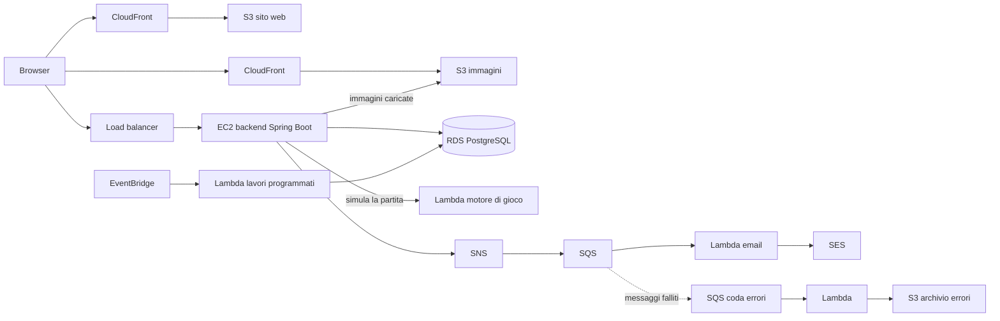

# Rilascio su AWS (ipotesi)

> **Stato:** ipotesi. Non fa parte della consegna e non si presenta al cliente.
> Il progetto si sviluppa e si consegna **in locale**. Questo documento serve solo a scrivere il codice in modo che, se un giorno serve, il passaggio ad AWS costi pochi giorni e non una riscrittura.

## 1. L'idea in breve

- Oggi tutto gira sul proprio PC: backend Spring Boot, motore come libreria dentro il backend, PostgreSQL in Docker, frontend servito da una cartella.
- Su AWS ogni pezzo avrebbe il suo servizio. Il codice resta lo stesso: cambiano **la configurazione** e **poche classi** dietro a un'interfaccia.
- Per questo bastano le [regole del capitolo 4](#4-regole-da-seguire-da-subito), da seguire già adesso.

## 2. Architettura ipotizzata

È lo schema disegnato alla lavagna, con una modifica: il backend gira su **un'istanza EC2** (non su ECS) e il motore di gioco su **AWS Lambda**.



| Pezzo | Servizio AWS | A cosa serve |
|-------|--------------|--------------|
| Sito | S3 + CloudFront | I file HTML, CSS e JavaScript del frontend |
| Immagini | S3 + CloudFront | Illustrazioni e copertine delle carte (`/images/...`) |
| Backend | EC2 (dietro il load balancer) | Le API REST di Spring Boot |
| Database | RDS per PostgreSQL | Lo stesso schema, le stesse migration Flyway |
| Motore di gioco | Lambda | Simula una partita: riceve i due mazzi, restituisce il risultato |
| Email | SNS → SQS → Lambda → SES | Email in coda (es. password dimenticata), con riprova se falliscono |
| Email fallite | Coda errori (DLQ) → Lambda → S3 | I messaggi che falliscono più volte si salvano per controllarli |
| Lavori programmati | EventBridge → Lambda | Lavori a orario, es. la chiusura della stagione delle leghe |
| Accesso | Cognito (sulla lavagna) | **Da decidere**, vedi il [capitolo 6](#6-punti-aperti) |

### Perché il motore su Lambda

Il motore è Java puro e non tocca il database: una partita entra come dati e esce come risultato. È il tipo di lavoro adatto a Lambda.

| Pro | Contro |
|-----|--------|
| Costo quasi zero: il piano gratuito di Lambda copre 1 milione di chiamate al mese | **Cold start:** con Java la prima chiamata dopo un periodo di inattività può durare 1–3 secondi. Si riduce con **SnapStart** e tenendo il motore senza dipendenze |
| Le simulazioni non pesano sul backend e Lambda scala da sola | Backend e motore si parlano in JSON: il formato va tenuto uguale da tutte e due le parti |
| Il motore si rilascia senza toccare il backend | L'EC2 deve poter chiamare Lambda: subnet pubblica oppure un VPC endpoint (a pagamento) |
| La regola "il motore non dipende da Spring" diventa obbligatoria per forza | Log separati in CloudWatch, e in locale la Lambda va simulata |

Non serve un framework come Quarkus o Micronaut: basta una piccola classe `Handler` che riceve il JSON, chiama il motore e restituisce il risultato. Il motore non sta in una VPC, perché non usa il database.

## 3. Dal locale ad AWS

| Pezzo | In locale (oggi) | Su AWS (ipotesi) | Cosa cambia nel codice |
|-------|------------------|------------------|------------------------|
| Frontend | Cartella servita in locale | S3 + CloudFront | Niente, se le chiamate usano percorsi relativi |
| Backend | `localhost:8080` | EC2 | Niente: solo variabili d'ambiente |
| Database | PostgreSQL 18 in Docker | RDS per PostgreSQL | Niente: solo `DB_URL`, utente e password |
| Motore | Libreria chiamata direttamente | Lambda | Un'altra implementazione di `BattleSimulator` |
| Immagini | Cartella sul disco | S3 | Un'altra implementazione di `FileStorage` |
| Email | Scritte nel log | SNS + SQS + Lambda + SES | Un'altra implementazione di `EmailSender` |
| Lavori programmati | `@Scheduled` di Spring | EventBridge + Lambda (oppure `@Scheduled` anche su AWS) | Nessuno, se la logica sta in un service |
| Segreti | `application-local.properties` (in `.gitignore`) | Parameter Store, passati come variabili d'ambiente | Niente |

## 4. Regole da seguire da subito

### 4.1 Motore di gioco

- Resta **Java puro**, come dice già [regole-codice.md](../regole-codice.md#motore-di-gioco-engine): niente Spring, JPA, database o HTTP.
- Dati in ingresso e in uscita **semplici e trasformabili in JSON**: record con stringhe, numeri, liste ed enum. Niente oggetti del backend, niente entità JPA, niente riferimenti circolari.
- Il `Random` arriva da fuori, come già previsto. Il backend crea un **seed** (`long`), lo salva con la partita e lo passa al motore, che fa `new Random(seed)`. Così la partita si può rifare uguale, sia in locale sia su Lambda.
- I valori di gioco restano in `GameRules`. Backend e motore si rilasciano **sempre insieme**, così usano le stesse regole.

### 4.2 Un'interfaccia davanti a ogni servizio esterno

Nel backend ogni servizio che su AWS cambierebbe sta dietro a un'interfaccia. Il resto del codice usa solo l'interfaccia, mai la classe concreta.

| Interfaccia (nome proposto) | Implementazione locale | Implementazione AWS (da scrivere solo se serve) |
|-----------------------------|------------------------|-------------------------------------------------|
| `BattleSimulator` | Chiama il motore direttamente | Chiama la Lambda |
| `FileStorage` | Salva in una cartella configurabile | Salva su S3 |
| `EmailSender` | Scrive l'email nel log | Pubblica il messaggio su SNS |

```java
// ✅ Il service conosce solo l'interfaccia: in locale o su AWS non cambia nulla
public class MatchService {

    private final BattleSimulator battleSimulator;

    public MatchService(BattleSimulator battleSimulator) {
        this.battleSimulator = battleSimulator;
    }
}

// ❌ Il service dipende dal modo in cui il motore viene eseguito
public class MatchService {
    private final BattleEngine engine = new BattleEngine();
}
```

L'implementazione si sceglie con i **profili di Spring**: `dev` per il locale, `aws` per il rilascio. Le classi AWS e le librerie dell'SDK di AWS **non si scrivono adesso**: si aggiungono solo il giorno in cui serve.

### 4.3 Configurazione

- Tutto quello che cambia tra locale e AWS si legge da **variabili d'ambiente**, con un valore di default per il locale.
- Mai indirizzi (`localhost`, IP), porte, password o chiavi scritti nel codice.

```properties
# ✅ application.properties: valore da variabile d'ambiente, default per il locale
spring.datasource.url=${DB_URL:jdbc:postgresql://localhost:5432/dreamscape}
app.storage.images-dir=${IMAGES_DIR:./data/images}
```

Variabili previste (elenco da completare):

| Variabile | Esempio in locale |
|-----------|-------------------|
| `DB_URL` | `jdbc:postgresql://localhost:5432/dreamscape` |
| `DB_USERNAME`, `DB_PASSWORD` | Quelle del proprio Docker |
| `JWT_SECRET` | Una stringa lunga, solo nel proprio `application-local.properties` |
| `IMAGES_DIR` | `./data/images` |
| `SPRING_PROFILES_ACTIVE` | `dev` |

### 4.4 Backend senza stato

- Niente `HttpSession` e niente dati degli utenti tenuti in variabili del server tra una richiesta e l'altra: tutto sta nel database o nel token JWT.
- Niente file scritti sul disco del server, a parte quelli che passano da `FileStorage`.
- I lavori programmati devono poter girare **due volte senza fare danni** (es. la chiusura di una stagione già chiusa non fa niente).
- La logica dei lavori programmati sta in un **service**: `@Scheduled` lo chiama e basta. Così su AWS lo può chiamare anche un'altra cosa.

### 4.5 Email

- L'email parte **dopo** che la transazione è andata a buon fine (`@TransactionalEventListener` con fase `AFTER_COMMIT`), non in mezzo.
- Se l'invio fallisce, la richiesta dell'utente non fallisce: l'errore si scrive nel log.

### 4.6 Indirizzi e frontend

- Le API restituiscono percorsi **relativi** per le immagini (`/images/cards/base-004-v1.webp`), come già scritto nella [guida per il frontend](../api/guida-frontend.md). Mai l'indirizzo completo con il dominio.
- Nel frontend l'indirizzo delle API sta in **un solo punto** (`api.js`), già previsto dalle regole.
- Frontend e API stanno sotto **lo stesso dominio** (in locale come su AWS). Serve perché il refresh token viaggia in un cookie `HttpOnly`.

### 4.7 Varie

- Date e ore in **UTC** nel codice e nel database (`Instant`, `timestamptz`). I server su AWS sono in UTC.
- I log si scrivono sulla **console**, non su file.
- Il backend espone un controllo di salute (`/actuator/health`), che il load balancer userebbe per capire se l'istanza funziona.

## 5. Cosa non facciamo adesso

- Niente account AWS, niente SDK di AWS nel codice, niente classe `Handler` per Lambda.
- Niente Docker obbligatorio per il backend: Docker serve solo per PostgreSQL.
- Niente parole su AWS nelle presentazioni al cliente.

## 6. Punti aperti

Da decidere solo se il rilascio su AWS diventa reale.

| Punto | Opzioni | Nota |
|-------|---------|------|
| Accesso | JWT nostro (già deciso il 26/10) oppure Cognito | Cognito cambierebbe registrazione e accesso. Con il JWT nostro il codice resta uguale |
| Dominio unico | Un solo CloudFront che manda `/api/*` al backend, oppure il load balancer su un dominio a parte | Con un dominio solo il cookie del refresh token funziona senza CORS. Con due domini serve `SameSite=None` |
| Load balancer | Tenerlo oppure CloudFront direttamente verso l'EC2 | Con una sola istanza il load balancer costa senza servire molto |
| Lavori programmati | EventBridge + Lambda oppure `@Scheduled` nel backend | Con un solo backend `@Scheduled` basta. Se la Lambda scrive direttamente su RDS, la logica si scrive due volte |
| Cold start del motore | SnapStart oppure niente | Con SnapStart la prima partita dopo una pausa parte molto più in fretta |
